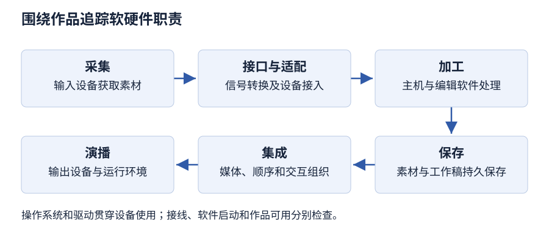

# 第 2 章 多媒体计算机系统

> 大纲定位：刘成明、石磊主编《多媒体技术及应用》（第三版，清华大学出版社，2021 年），对应江苏省课程代码 13511《多媒体技术与应用》江南大学编 2024 年大纲。学习重点是系统架构、硬件职责及软件分类，讲解和练习独立编写。

!!! note "版本与来源"

    本章依据《多媒体技术及应用（第三版）》首轮重点校对稿整理，成书尚未逐字终校；软件步骤按教材所用版本描述，未在本机实测。原书疑点见[版本与勘误](../../errata.md)。

## 复习导航

| 大纲短考点 | 层次 | 讲解 | 自编练习 |
| --- | --- | --- | --- |
| 系统含义与基本架构 | 识记、领会 | [第 1 节](#s1) | 1 |
| 多媒体主机 | 识记、领会、简单应用 | [第 2 节](#s2) | 1、7 |
| 多媒体接口设备 | 识记、领会、简单应用 | [第 3 节](#s3) | 2、7 |
| 多媒体存储设备 | 识记、领会、简单应用 | [第 4 节](#s4) | 3 |
| 多媒体输入设备 | 识记、领会、简单应用 | [第 5 节](#s5) | 2、4 |
| 多媒体输出设备 | 识记、领会、简单应用 | [第 6 节](#s6) | 4 |
| 操作系统与驱动程序 | 识记、领会 | [第 7 节](#s7) | 5 |
| 素材软件、集成工具与应用软件 | 识记、领会 | [第 8 节](#s8) | 6 |

## 1 沿信息处理过程理解系统架构 {#s1}

所谓多媒体计算机系统，是能对多种媒体信息做综合处理的计算机系统。做法是在普通计算机里加上处理多媒体的软硬件环境，用各种接口把部件连成整体，让各部分配合起来，共同完成媒体信息的采集、加工、存储、集成与演播。

它的基本架构分为硬件系统和软件系统两部分。硬件系统主要包括多媒体主机、多媒体适配卡、多媒体数据存储设备和多媒体输入输出设备，通信传输设备及接口装置也属于硬件；软件系统由运行环境（操作系统）、设备驱动、素材采集与处理软件、创作集成工具和应用软件组成。

按一次录制任务走一遍，就能看到这些部件各在什么位置：话筒、摄像机提供素材，适配卡把信号接进主机，主机在操作系统和编辑软件控制下加工，存储设备保存素材和结果，输出设备把作品放出来。采集、加工、存储、集成和演播这几段衔接不上，系统就完不成一件作品。

采集端正常工作，演播端仍可能缺少合适的设备；硬件已经连通，软件环境也可能尚未就绪。所以“能录入”“能处理”“能保存”“能播放”要分别检查，最后再检查声音、画面与操作能否共同完成作品。系统集成的基本特征见[第 1 章](chapter-01.md)。

## 2 主机类别与任务侧重点 {#s2}

多媒体主机按用途和功能分三类。

第一类是多媒体个人计算机（MPC），做法是在通用个人计算机里加装多媒体接口卡、相关设备和软件，把它升级成多媒体个人计算机，也有厂商直接提供带多媒体处理功能的整机。这类机器如今用得最多。

第二类是针对特殊用途或专门领域设计的专用多媒体计算机系统，多媒体功能做在主板的专用芯片上，甚至集成进 CPU 芯片；Intel 与 IBM 早年合作推出的 DVI 系列就属于这一类，能把声音、文字、图像和影像放在一起处理。

第三类是多媒体工作站，性能强，Sun、SGI、HP 等厂商都出过这类产品，运算快、存储大、图形图像处理能力强，支持 TCP/IP 等网络协议，可承担要求较高的多媒体应用。

三类主机按设计用途和处理能力区分。

## 3 接口与适配卡承担什么转换 {#s3}

显卡又叫显示适配器，它连接主机和显示器，把主机算好的数字信号变成图像信号送出去。工作时，显示芯片先接收 CPU 发来的图形处理指令并完成运算，结果暂存在显存里；随后由显存上的数模转换器（DAC）把数字信号变成显示器可接收的模拟视频信号。显卡的核心是显示芯片，又叫加速芯片或图形处理器（GPU）。独立显卡自带显存、不占用系统内存，性能比集成显卡好。

声卡也叫声音适配器，个人多媒体计算机一般都要配一块，作用是把声波和数字信号互相转换。它负责声音的采集、编码、压缩、解压和回放，支持录音与编辑、模数与数模转换、语音合成与识别以及 MIDI 音乐合成。话筒拾取声音，音箱把输出变成人耳听到的声音，声卡在两者之间做适配与处理。声音数字化的细节见[第 5 章](chapter-05.md)。

视频卡负责视频信息处理，按功能分视频采集卡（视频捕捉卡）、视频压缩卡（MPEG 卡）、视频输出卡和 TV 编码器等专用卡。采集卡把录像带、影碟或摄像机的模拟视频采样数字化，以数字视频文件存入计算机；压缩卡依据 MPEG 标准，把视频信号压缩后再解压；输出卡把显卡输出的 VGA 信号转成符合 NTSC 或 PAL 制式的视频信号，供电视机等设备播放。

压缩卡是单独一类适配卡，把模拟信号或数字信号按一定算法压缩后采集到硬盘，或直接刻录成光盘。常见的硬件压缩卡压缩比一般不超过 1:6，不占用 PC 资源；软件压缩卡的压缩比由软件决定，没有固定标准，对主机配置要求更高。压缩分帧内压缩和帧间压缩。

## 4 存储介质、用途与性能指标 {#s4}

多媒体的数据量很大，素材需要长期保存，作品发行也要有高容量、便于移动的介质。半导体存储器按功能分两类：一类是 RAM（随机存取存储器），另一类是 ROM（只读存储器）。RAM 包括 DRAM 和 SRAM，DRAM 主要用作主存，SRAM 主要用作高速缓存；关机或断电时，RAM 中的信息随之丢失。存储卡、闪存器和 U 盘都属于半导体存储器，体积小、存储速度快、容量大、携带方便。

移动硬盘用硬盘做存储介质，主打便携和大容量数据交换，接口多为 USB、IEEE 1394 一类。它的特点是容量大、传输速度快、使用方便、可靠性高，并具有防振功能。

激光存储器就是光盘，常见的载体有 CD、DVD 和 HD DVD。一张光盘大致三层：底层是透明基底，中间那层反光金属记录信息，最上面加保护层。读取光盘用光盘驱动器，写入光盘要刻录机；按能否写入分三种：只读的 CD-ROM 驱动器、一次写入的 WORM 驱动器和可反复擦写的可重写驱动器。

固态硬盘用半导体存储片（如 RAM、E²PROM、Flash）存储数据，没有传统硬盘读写时旋转、移动的机械部件。它的接口规范、功能和使用方法与普通硬盘相同，外形尺寸也一致。存储介质有闪存和 DRAM 两种：闪存是非易失性的，DRAM 是易失性的，需要内部电源防止掉电丢失数据。固态硬盘的优点是启动与存取都快、没有噪声、耗电少，还防振抗摔。

衡量存储器要同时看几个指标：存储容量说明能存多少，存取时间说明一次读写要多久，存取周期是两次独立存储操作之间所需的最小间隔，平均故障间隔时间（MTBF）和功耗也属于技术指标。容量大只说明存得下，读写快慢还要看存取时间和传输条件。携带素材去另一台机器继续编辑，除容量外还要检查接口与便携性；只在处理过程中临时存放的数据，则先看主存的职责。

## 5 输入设备与素材获取的差别 {#s5}

输入设备把人的操作或外部内容交给系统。键盘、鼠标提供操作与字符输入；话筒把声音转换成电信号，是声音输入的起点；触摸屏属于输入设备，它是一块能感知触头信号的感应式液晶屏。按技术原理，触摸屏分为电阻式、电容式、压电式、红外线式和表面声波式五类。触摸屏同时带有显示画面，显示画面承担输出，触头感应承担输入。

平面扫描仪用光电技术和数字处理技术，把照片、文本页面、图纸、平面实物等转成可以编辑的数字图像。常见类型有平板式、滚筒式、便携式、馈纸式等。扫描仪的性能看四样：分辨率、色彩深度、速度和幅面。分辨率按每英寸多少像素点（dpi）计，数值越高图像越清晰；色彩深度用位数表示颜色；速度受分辨率、色彩模式和幅面影响。扫描得到文字图片后，还要经文字识别才成为文本素材，见[第 3 章](chapter-03.md)。

三维扫描仪侦测物体或环境的形状与外观数据，用于三维重建，得到实物的数字模型。按测量方法分五类：接触式通过触碰计算深度，精度高但可能损伤对象；时差测距式用激光往返一趟的时间换算距离；三角测距式由激光光点、摄影机与激光构成的三角形计算距离；结构光源式把图样投到物体上，按变形判断表面形状；非接触被动式不发射辐射线，靠接收物体反射的环境光重建。

语音识别系统让人不用双手就能操作设备，应用分两个方向：大词汇量连续语音识别用于计算机听写、电话网或互联网上的语音查询；小型化便携式产品用于手机拨号、汽车语音控制、智能玩具和家电遥控。数码相机主要拍摄静止画面，也能拍短时间的动态影像，性能指标有分辨率、色彩深度、存储卡容量和输出接口；数码摄像机记录连续活动影像和同步声音，指标有分辨率与帧频、色彩深度、传输速率、音频质量和拍照像素。数码相机用 CCD 或 CMOS 感光元件把光信号转成电信号，再经模数转换后存到存储卡。

## 6 输出面向听觉、视觉与实体结果 {#s6}

音频设备包括功放、音箱、调音台、合成器、耳机等。功放把信号源或调音台送来的微弱电信号放大，驱动扬声器发声；音箱把声卡输出的音频信号转换成声音波形播放，分有源（内置功放）和无源两种；调音台负责多路信号的放大、混合、分配和音质修饰，还能加音响效果，分模拟式和数字式两类。判断音质看几项参数：信噪比、采样位数、采样频率和总谐波失真。

显示器向用户呈现画面，按制造材料和技术分为 CRT、LCD、LED、3D 显示器和等离子显示器（PDP）等。CRT 使用阴极射线管；LCD 靠液晶粒子转动组合红、绿、蓝三原色；LED 用发光二极管显示文字、图形、图像和视频；3D 显示器让两只眼睛接收不同画面形成立体感；PDP 激发气体室发出紫外光，再打到红、绿、蓝荧光体上发出可见光。

投影仪把画面投到大屏幕，供较多观众观看，按成像原理分为 CRT 三枪投影机、LCD 投影仪和 DLP 投影机。CRT 三枪投影机把输入信号分解成红、绿、蓝三路，由三个投影管投射；LCD 投影仪利用液晶的光电效应控制透光率；DLP 投影机用数字微镜装置（DMD）反射光线成像。

打印机把结果输出到介质上，衡量指标是打印分辨率、打印速度和噪声。按技术分针式、喷墨、激光等各类。三维打印机采用层层堆积的方式分层制作三维模型，属于快速成型工艺；把实物表面转成模型要用三维扫描，把已有模型做成实物要用三维打印，两者方向相反。

## 7 操作系统与驱动程序的支持关系 {#s7}

软件系统里，操作系统处在核心位置；它下面依次有驱动程序；多媒体素材采集处理软件负责素材的采集与加工；创作集成工具把素材组织成作品；应用软件交付给用户。软件系统还常配多媒体数据库管理、压缩与解压、声像同步、通信等专门软件。

操作系统提供运行与资源管理环境。多媒体操作系统与普通操作系统的界线已不太分明；Windows、macOS、iOS、Android 这些桌面与移动系统都在承担多媒体的运行支持。

驱动通常由硬件厂商提供，和硬件设备一起销售。把硬件接到计算机上，装好对应驱动，设备就能正常使用；现在多数硬件支持即插即用，安装更为方便。

设备连上主机只说明建立了物理联系，要真正采集或播放，还要有合适的驱动和软件支持。操作系统支撑整体运行，驱动提供具体设备的软件支持，编辑软件完成任务操作，三者与硬件齐备，采集和播放才能成立。

## 8 从单项素材到完整作品 {#s8}

素材制作软件围绕文本、图形、图像、音频、视频和动画采集或加工素材。文本类有 Word、WPS、写字板和记事本，OCR 软件把扫描得到的含文字图片识别成文本；图形类有 CorelDRAW、AutoCAD、FreeHand 和 Illustrator；图像类有 Photoshop 和系统自带的“画图”，抓图工具有 SnagIt 等；音频类有录音机、Cool Edit、Gold Wave 和 Audition；视频类有会声会影和 Premiere；动画类有 Animate、GIF Animator、3D Studio Max、Cinema 4D、After Effects 和 Cool 3D。软件可能跨类工作，类别说明的是当前主要任务。

创作集成工具把不同素材组织、编辑、管理并组合成有交互功能的作品。PowerPoint 是以页面制作为基础的集成工具；Animate 可以创建演示文稿、应用程序和可交互内容；Dreamweaver 用来做网页并管理网站，编辑界面所见即所得；也可以直接用程序设计语言，如 Visual Basic，作为集成工具。

多媒体应用软件交给用户直接使用，比如电子出版物、教学课件、演示系统和咨询服务系统。它由开发工具把文本、图形、图像、声音、视频和动画集成后封装打包，能脱离原开发环境独立运行。开发工具是制作手段，应用软件是用户使用的结果。

### 自编任务：为同一作品配置制作端与使用端

工作室要制作访谈导览，交给固定地点的观众使用。先按环节列出制作端和使用端各要确认的条件，再检查是否缺少某个环节。

| 环节 | 制作端要确认 | 使用端要确认 |
| --- | --- | --- |
| 输入 | 摄像、录音及相应接口 | 用户选择或控制方式 |
| 处理 | 编辑工具、主机和驱动 | 运行作品的软件条件 |
| 保存 | 素材、工程与备份 | 可用作品及访问位置 |
| 输出 | 预览画面、声音 | 显示、播放与音量控制 |

在制作端能预览，不足以说明使用端可用；把交付副本放入目标环境，再检查播放与操作。

## 本章小结

- 多媒体计算机系统在普通计算机上配以多媒体软硬件环境，经接口连接、协同完成采集、加工、存储、集成和演播；基本架构分硬件系统与软件系统。
- 主机分多媒体个人计算机、专用系统和多媒体工作站；适配卡、存储与输入输出设备各承担不同转换任务，接口连通后还要有驱动和软件支持。
- 容量、存取时间与介质特性分别判断，RAM 中的暂存数据断电即失；素材制作软件、创作集成工具和应用软件按工作阶段区分，同一工具可以跨类。

## 自编练习

**1. 一处展馆的固定导览系统负责展示内容，编辑人员另用通用计算机整理素材。请解释两者为何都要软硬件协同，并说明判断主机类别还缺哪些信息。**

考点：第 1、2 节；层次：识记、领会。

**答案：** 展示和编辑都要依赖主机、输入输出、存储与软件支持，只有素材或机箱完不成作品。编辑端通常是多媒体个人计算机；固定导览只是用途描述，还要确认它是否围绕专门任务设计，才能判断是否属于专用多媒体计算机系统。

**2. 资料员要把旧录像设备的影像转入计算机，另录一段说明音。现有音箱、话筒、显示器和主机。分别指出影像采集与声音采集链中应检查的适配职责。**

考点：第 3、5 节；层次：识记、领会、简单应用。

**答案：** 影像链要检查能接收外部视频并完成采集的视频采集卡，显示器只负责把结果呈现出来。说明音由话筒拾取，属于声音输入；还要有声卡完成模数与数模转换、录制和编码。音箱用于播放，属于输出。

**3. 学员说：“素材还在运行中的内存里，所以已经可以关机；另外，只要购买容量更大的介质，读取一定更快。”请分别说明这两个说法的问题。**

考点：第 4 节；层次：识记、领会、简单应用。

**答案：** RAM 中的信息在关机或断电时丢失，素材应保存到非易失的存储介质。容量与存取时间是两个指标：容量说明能存多少，读写快慢看存取时间和传输条件，容量加大并不自动带来更快的读取。

**4. 工作室要给一件自制模型建立数字外形，再把修改后的模型制成实体，并向一群观众展示介绍。为这三项任务分别选设备类别，说明输入输出方向。**

考点：第 5、6 节；层次：识记、领会、简单应用。

**答案：** 三维扫描仪侦测物体形状与外观，属于输入；三维打印机用层层堆积形成实体，属于输出；投影仪把介绍画面投给观众，也属于输出。平面扫描仪得到的是二维图像，和三维几何采集是不同任务。

**5. 新采集设备已经接线，编辑软件也能启动，但这是否足以说明采集环境完整？分别说出操作系统、驱动与编辑软件在判断中的位置。**

考点：第 7 节；层次：识记、领会。

**答案：** 接线和软件能启动只说明物理连接与部分软件就绪。操作系统支撑整体运行，驱动提供具体设备的接口支持，编辑软件完成任务操作；三者与硬件配套，采集或播放才能成立。

**6. 团队先修整照片、录制解说，再把素材与导航合成为可供访客使用的导览作品。请分出素材制作、创作集成和应用软件，并解释工具能跨类为何不影响这种分析。**

考点：第 8 节；层次：识记、领会。

**答案：** 修图与录音属于素材制作，组织素材和导航属于创作集成，交给访客操作的导览作品属于应用软件。分类依据是正在完成的职责；同一工具可能承担多个阶段，要说清它在该阶段是加工素材还是组织完整应用。

**7. 两个方案都能播放导览：甲在通用个人计算机上增加采集设备和编辑软件；乙从硬件到界面均围绕单一导览任务设计。判断主机类别，并说明“二者都有屏幕”为什么不能替代接口和运行条件检查。**

考点：第 2、3 节；层次：识记、领会、简单应用。

**答案：** 甲是在通用计算机上增加多媒体能力的多媒体个人计算机方案；乙按题设围绕专门用途设计，属于专用多媒体计算机系统。屏幕承担显示输出，录音、视频输入和驱动是否具备要另查。应分别追踪输入、适配、处理与演播的职责，不能只凭外观判断系统是否完整。
