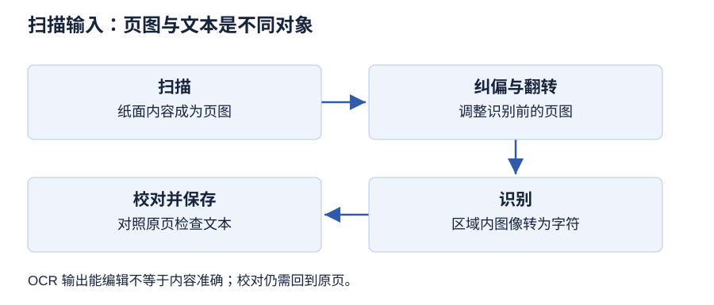

# 第 3 章 文本处理技术

> 大纲定位：刘成明、石磊主编《多媒体技术及应用（第三版）》（清华大学出版社，2021 年），对应江苏省高等教育自学考试 13511《多媒体技术与应用》大纲（江南大学编，2024 年）。

## 学习导航

| 大纲短考点 | 层次 | 讲解 | 练习 |
| --- | --- | --- | --- |
| 文本与西文编码 | 识记 | [第 1 节](#s1) | 1 |
| 汉字编码 | 识记 | [第 2 节](#s2) | 1 |
| Unicode 编码 | 识记 | [第 3 节](#s3) | 2 |
| 文本类型与存储类型 | 识记 | [第 4 节](#s4) | 3 |
| 文本输入方法 | 识记 | [第 5 节](#s5) | 4 |
| OCR 与扫描输入步骤 | 识记、领会 | [第 6 节](#s6) | 4 |
| 文本处理与格式文本技术 | 识记、领会 | [第 7 节](#s7) | 5 |
| Word 主要功能 | 识记 | [第 8 节](#s8) | 6 |

## 应试导航 {#exam}

本章考纲分 8 个条目。层次分布：第 1 至第 5 节只要求识记，第 6 节与第 7 节要求识记与领会，第 8 节只要求识记。准备策略：编码条目要能背换算方法而不只是名称；文件类型条目按用途背；两个领会条目按“三个环节”“三个层次”的顺序背，答题时先报环节或层次，再各补一句。

### 考纲考点与卷面位置

| 考纲条目 | 层次 | 教材位置 | 常见出法 | 要背到哪一步 |
| --- | --- | --- | --- | --- |
| 1.1 文本与二进制编码 | 识记 | 第 1 节 3.1 文本信息在计算机中的表示 | 填空题，问文本靠什么存储、用什么编码 | 文本定义与“按指定二进制编码存储”一句 |
| 1.2 ASCII 码 | 识记 | 第 1 节 3.1.1 西文编码 | 判断题，问一个字符占几位、能表示多少字符 | 7 位、128 个；“A”65、“a”97 |
| 2.1 国标码与区位码 | 识记 | 第 2 节 3.1.2 汉字编码 | 换算题或填空题，问区位码怎样变成国标码 | 94×94 区位、各字节加 20H、6763 与 682 两个数 |
| 2.2 机内码 | 识记 | 第 2 节 3.1.2 汉字编码 | 说明题，问国标码为什么不能直接用作机内码 | 最高位由 0 改 1、各字节加 80H、字节都大于 128 |
| 2.3 输入码（音码、形码） | 识记 | 第 2 节 3.1.2 汉字编码 | 分类题，问拼音与五笔各属哪类输入码 | 顺序码、音码、形码、音形码 4 类 |
| 3.1 Unicode 与跨语言、跨平台 | 识记 | 第 3 节 3.1.3 Unicode 编码 | 名词题，问 Unicode 解决什么问题 | 统一且唯一的二进制编码，跨语言、跨平台 |
| 4.1 无格式文本、格式文本、超文本 | 识记 | 第 4 节 3.2 文本的类型 | 判别题，给文件或需求问属哪种文本 | 三种类型的区别在存不存格式与有没有链接 |
| 4.2 常见文件类型与用途 | 识记 | 第 4 节 3.2 表 3-1 | 匹配题，给扩展名问用途 | .txt、.rtf、.doc、.pdf、.htm、.asp、.js、.css 各一句 |
| 5.1 键盘输入、手写输入、语音输入 | 识记 | 第 5 节 3.3.1 至 3.3.3 | 列举题，问手写系统由哪三部分组成 | 4 种输入途径，手写三部分 |
| 6.1 OCR 与扫描输入三环节 | 识记、领会 | 第 6 节 3.3.4 扫描输入 | 步骤题，问扫描输入要经过哪几步、条件是什么 | 扫描、纠偏和翻转、识别；300 线与非压缩 TIFF |
| 7.1 格式文本处理的三个层次 | 识记、领会 | 第 7 节 3.4.1 文本信息处理 | 定位题，给现象问属哪个层次 | 版面格式、文字属性、非文本内容排版 |
| 8.1 Word 的主要功能 | 识记 | 第 8 节 3.4.2 Word 文字处理软件 | 列举题，问某项操作属哪个功能 | 五项功能名称与各自内容 |

### 常见出法（按大纲题型）

| 问法 | 出题依据 | 应对 |
| --- | --- | --- |
| 编码换算 | 识记层次，条目自带换算关系 | 写清十进制与十六进制两步，加 20H 或 80H |
| 位数与容量 | 识记层次，ASCII 与区位表都有定数 | 先报位数，再报可表示个数 |
| 类型归属 | 识记层次，文本按存储内容分类 | 看存的是字符、字符加格式还是字符加链接 |
| 扩展名匹配 | 识记层次，文件类型按用途区分 | 答用途，不只答名称 |
| 步骤复述 | 识记、领会层次，OCR 是流程性条目 | 按顺序写三步，条件补在第一步 |
| 问题定位 | 领会层次，三个层次处理对象不同 | 先判对象是整页、文字还是非文本内容 |

### 必背名词

| 术语 | 必背一句话 | 常考 |
| --- | --- | --- |
| 文本 | 以文字和各种专用符号表达的信息形式，主要用于对信息的描述性表示 | 名词 |
| ASCII | 美国信息交换标准代码，基本集用 7 位二进制表示一个字符，可表示 128 个字符 | 名词、填空 |
| 扩展 ASCII | 用 8 位二进制表示一个字符、最高位恒为 1 的编码，可表示 128 个字符 | 判断 |
| 国标码 | GB 2312—1980 规定的汉字交换用编码，由连续两个字节组成 | 名词 |
| 区位码 | 汉字或符号在 94 区 94 位方阵中的位置编码 | 换算 |
| 机内码 | 国标码每字节最高位由 0 改 1 所得的变形国标码，用于计算机内部存储 | 换算、说明 |
| 输入码 | 使用英文键盘输入汉字时使用的编码，分顺序码、音码、形码、音形码 4 类 | 分类 |
| Unicode | 统一字符编码标准，为每种语言的每个字符设定统一且唯一的二进制编码 | 名词 |
| 无格式文本 | 只存储文字信息本身、以固定大小和风格输出的文本，又称纯文本 | 判别 |
| 格式文本 | 除文字基本信息外还保存字号、颜色、字体及其他输出格式与排版信息的文本 | 判别 |
| 超文本 | 以非线性方式组织、按内容含义分块并用超链接组成网状结构的文本 | 名词 |
| 超媒体 | 除文本块外还包含图片、声音、视频、动画并能通过超链接组合使用的超文本 | 名词 |
| OCR | 光学字符识别，能从扫描的图像中识别出文字的技术 | 名词、步骤 |
| 版面格式设置 | 对页边距、页眉页脚、版心文字排列方向、纸张类型等的设置 | 定位 |
| 文字属性 | 文字的字体、字号、风格、颜色、对齐方式等属性 | 列举 |

### 必背清单

**第 1 节**

1. 【考纲 1.1】文本是以文字和各种专用符号表达的信息形式，是现实世界中使用最多的一种信息存储和传递方式；计算机系统通过指定的二进制编码存储数字、字母和其他字符，西文字符与汉字的编码方式不同。
2. 【考纲 1.2】ASCII 码包括数字、字母、特殊符号等，是现今通用的单字节编码系统，也是使用最广泛的一种编码。
3. 【考纲 1.2】基本 ASCII 用 7 位二进制表示一个字符，共能表示 $2^7=128$ 个不同字符，含 26 个大写字母、26 个小写字母、0 至 9 十个数字、算术与逻辑运算符号和标点符号。
4. 【考纲 1.2】扩展 ASCII 用 8 位二进制表示一个字符，最高位 b7 总是 1，可表示 128 个字符，扩充了表格符号、计算符号、希腊字母和特殊的拉丁符号。

**第 2 节**

5. 【考纲 2.1】国标码出自 1981 年 5 月颁布的《信息交换用汉字编码字符集基本集》，代号 GB 2312—1980，由连续两个字节组成。
6. 【考纲 2.1】GB 2312 收录 6763 个常用汉字和 682 个数字和图形字符，其中一级汉字 3755 个按拼音顺序排列、二级汉字 3008 个按部首排列。
7. 【考纲 2.1】GB 2312 把汉字与符号排成 94×94 的方阵，每行是一个“区”（区号 01～94），每列是一个“位”（位号 01～94），字符在方阵中的位置就是区位码。
8. 【考纲 2.1】区位码转国标码：先把十进制区位码转为十六进制，再把两个字节分别加 20H（十进制各加 32）；“刘”字由 3385D 转 2155H 后加 2020H 得国标码 4175H。
9. 【考纲 2.2】国标码两字节最高位都是 0，会与 ASCII 码冲突产生二义性，因此不能直接在计算机内部采用；机内码把国标码每个字节都加 128，即最高位由 0 改 1、十六进制直接加 8080H，“刘”字机内码为 C1F5H。
10. 【考纲 2.2】汉字机内码的每个字节都大于 128，因而与西文字符的 ASCII 码不再冲突。
11. 【考纲 2.3】输入码分顺序码、音码、形码、音形码 4 类，最普及的是拼音输入法与五笔字型；不管用哪种输入法输入同一个汉字，其机内码都相同。

**第 3 节**

12. 【考纲 3.1】Unicode 又称万国码、单一码；从 1990 年起由多家计算机公司的语言学家、信息专家和工程师合作，对多种文字文本和字符进行 16 位编码，形成统一的编码方案。
13. 【考纲 3.1】Unicode 于 1994 年正式公布，标准中包含超过 18000 个汉字（中日韩使用的象形文字），中文范围是 4E00～9FBF，并保留部分编码空间供用户专门用途。

**第 4 节**

14. 【考纲 4.1】无格式文本只存储文字信息本身，文字以固定大小和风格输出，通常保存为 .txt，用记事本一类简易编辑器即可编辑，无法定义文本格式和版面格式。
15. 【考纲 4.1】格式文本除文字基本信息外还包含字号、颜色、字体以及其他规定输出格式的排版（如表格、分栏）信息，要用 Word、WPS 一类功能较强的软件编辑。
16. 【考纲 4.1】超文本以非线性方式组织，把内容按含义分割成文本块，再按逻辑关系通过超链接组织成网状结构；纯超文本文件由 HTML 与按 HTML 格式要求分割的文本块组成，含多种媒体时称超媒体。
17. 【考纲 4.2】常见文本存储类型：.txt 纯文本、.rtf 跨平台格式文本、.doc/.docx Word 文件、.wps WPS 文件、.ppt 演示文档、.pdf 便携式文件、.htm/.html 静态超文本、.asp/.aspx 动态超文本、.js 脚本文件、.css 样式文件、.tiff 标签图像文件格式。

**第 5 节**

18. 【考纲 5.1】键盘输入是传统的主要输入方法，英文可直接输入，中文需通过中文输入法，常用搜狗拼音、五笔字型、微软拼音输入法。
19. 【考纲 5.1】传统手写输入系统由手写笔、手写板、手写识别软件 3 部分组成，适合不习惯键盘操作的人群与没有标准英文键盘的场合。
20. 【考纲 5.1】语音输入通过声卡和麦克风采集语音，再经语音识别转成文字；第一次使用要做麦克风调试与短时间的语音“适应”训练，朗读词句越多正确率越高，可超过 90%。

**第 6 节**

21. 【考纲 6.1】扫描输入的核心是光学字符识别技术（OCR），即用扫描仪把印刷文字以图像方式扫入计算机，再用 OCR 软件识别出文字并转换为文本格式文件。
22. 【考纲 6.1】扫描输入 3 步：第一步扫描，扫描线数要在 300 线以上、图片格式为非压缩的 TIFF；第二步纠偏和翻转，把歪斜或倒置的页图扶正；第三步识别，框选文字区域识别后保存为文本文件，可疑文字会以不同颜色标出并可手工修改。

**第 7 节**

23. 【考纲 7.1】格式文本处理的主要目的是出版发行，技术方面含版面格式设置、文字属性编辑、非文本内容排版三部分。
24. 【考纲 7.1】版面格式设置包括页边距、页眉及页脚的设置，版心区域文字的排列方向和纸张类型。
25. 【考纲 7.1】文字属性包括字体、字号、风格、颜色、对齐方式；字体由安装的字库提供，字体文件扩展名多为 fon 及 TTF，TTF 支持无级缩放；汉字字号分初号至八号，初号最大，西文以“磅”为单位，最小 5 磅、最大 72 磅，正文一般选五号。
26. 【考纲 7.1】非文本内容排版指在文本不同位置插入图片、表格、数学公式、文本框等，使版面综合利用各种表现形式。

**第 8 节**

27. 【考纲 8.1】Word 的主要功能分五类：内容编辑（插入、修改、删除、复制）、图文混排（插入或链接剪贴画、图片、图像、艺术字与声音）、表格功能（多种表格模式、自动调节列宽、数据汇总计算）、排版功能（字符与段落格式、页眉页脚、纸张大小与页边距、所见即所得）、特殊功能（公式编辑、文件格式转换、打印预览、网页浏览与制作）。

### 必背数字与公式

| 项目 | 必背内容 |
| --- | --- |
| 基本 ASCII | 7 位二进制，$2^7=128$ 个字符 |
| 扩展 ASCII | 8 位二进制，最高位恒为 1，可表示 128 个字符 |
| 码值示例 | “A”为十进制 65，“a”为 97 |
| GB 2312 收录 | 6763 个汉字与 682 个符号；一级 3755 个、二级 3008 个 |
| 区位方阵 | 94 区 × 94 位，区号 01～94，位号 01～94 |
| 区位码转国标码 | 区位码转十六进制后各字节加 20H（十进制各加 32） |
| 国标码转机内码 | 各字节加 80H（十进制加 128），即最高位由 0 改 1 |
| 换算示例 | 3385D 得 2155H，加 2020H 得国标码 4175H，机内码 C1F5H |
| Unicode | 16 位编码方案，1994 年公布，汉字超过 18000 个，中文范围 4E00～9FBF |
| 汉字字号 | 初号最大、八号最小；初号 42 磅，一号 26 磅，小四 12 磅，五号 10.5 磅 |
| 西文磅值 | 最小 5 磅、最大 72 磅；正文一般五号 |
| OCR 扫描条件 | 扫描线数 300 线以上，图片为非压缩的 TIFF 格式 |
| 语音识别正确率 | 训练后可超过 90% |
| 输入码类别 | 4 类：顺序码、音码、形码、音形码 |

### 易混对照

| 对照项 | 区别 | 判断依据 |
| --- | --- | --- |
| 编码与字体 | 编码决定字符在计算机里怎样记；字体提供显示的字形 | 换字体后字符编码不变 |
| 区位码与国标码 | 区位码是十进制区号位号组成的码表位置；国标码是区位码各字节加 20H 后的交换码 | 有没有做十六进制转换与加 20H |
| 国标码与机内码 | 国标码用于交换、两字节最高位为 0；机内码用于内部存储、最高位为 1 | 字节值是否都大于 128 |
| 输入码与机内码 | 输入码决定用键盘怎样选中汉字；机内码决定汉字在机内怎样表示 | 换输入法后机内码是否变化 |
| 无格式文本与格式文本 | 无格式文本只存文字本身；格式文本连字号、颜色、字体与版面信息一起存 | 格式能否随文字一起保存 |
| 超文本与超媒体 | 超文本以文本块加超链接组织；超媒体还含图片、声音、视频、动画等媒体 | 链接的是不是只有文本块 |
| 键盘输入与扫描输入 | 键盘逐字键入；扫描输入先得页图再由 OCR 识别 | 有没有经过图像与识别环节 |
| 语音输入与扫描输入 | 语音输入处理声音信号；扫描输入处理印刷页面的图像 | 原始材料是口头话语还是纸面文字 |
| 版面格式与文字属性 | 版面格式管整页的页边距、页眉页脚、排列方向与纸张；文字属性管字体字号风格颜色对齐 | 出问题的是整页边界还是某段文字外观 |
| 内容编辑与排版功能 | 内容编辑改文字本身；排版功能改字符与段落格式、页面设置 | 改动的是文字内容还是呈现格式 |

### 简答答题模板

**区位码转换成国标码的方法**

两步：先把十进制的区号、位号分别转换成十六进制，得到一个与国标码有相对位置差的代码；再把这个代码的第一个字节和第二个字节分别加 20H（若按十进制就是各加 32）。举例写“刘”字 3385D 转 2155H 再加 2020H 得 4175H。

**文字属性编辑的内容**

五项各一句：字体由字库提供、按用途选宋体黑体等；字号用汉字字号或磅值表示，正文一般五号；风格含普通、加粗、斜体、下画线、字符边框、字符底纹、阴影；颜色按需要指定；对齐方式含左对齐、右对齐、居中、两端对齐、分散对齐。

**使用扫描输入的一般步骤**

三步：扫描，扫描线数 300 线以上并存为非压缩 TIFF；纠偏和翻转，把歪斜或反向的页图校正；识别，框选文字区域执行识别并保存为文本文件，可疑文字按颜色标记后手工修改。末句写 OCR 适合把印刷文字重新输入计算机。

**超文本和超媒体的联系与区别**

联系：超媒体是在超文本基础上发展起来的，两者都用超链接组织内容。区别：超文本的内容是文本块；超文本中除文本块外还含图片、声音、视频、动画等媒体并可通过超链接组合使用时，称为超媒体。

**中文版 Word 的主要功能**

五类各一句：内容编辑、图文混排、表格功能、排版功能、特殊功能（公式编辑、文件格式转换、打印预览、网页浏览与制作）。末句补“所见即所得”。

**三种文本类型的区别**

无格式文本只存文字、显示固定；格式文本连字号颜色字体与排版信息一起存；超文本按含义分块并用超链接组成网状结构。判断时看文件里有没有格式信息、有没有链接关系。

### 默写自测

先合上上面的内容写完，再展开对照。

1. 计算机系统通过指定的\_\_\_\_来存储数字、字母和其他字符。
2. 基本 ASCII 用\_\_\_\_位二进制表示一个字符，可表示\_\_\_\_个不同字符。
3. 字母“A”的 ASCII 码值为\_\_\_\_，小写“a”为\_\_\_\_。
4. 国标码代号为\_\_\_\_，由连续\_\_\_\_个字节组成。
5. GB 2312 收录常用汉字\_\_\_\_个、数字和图形字符\_\_\_\_个。
6. 一级汉字\_\_\_\_个按拼音排列，二级汉字\_\_\_\_个按部首排列。
7. GB 2312 把汉字与符号排成\_\_\_\_的方阵，行称\_\_\_\_、列称\_\_\_\_。
8. 区位码转国标码时，两个字节分别加\_\_\_\_；国标码转机内码时，两个字节分别加\_\_\_\_。
9. 汉字输入码按编码依据分\_\_\_\_、\_\_\_\_、\_\_\_\_、\_\_\_\_ 4 类。
10. Unicode 又称\_\_\_\_、\_\_\_\_，于\_\_\_\_年正式公布。
11. 文本在计算机系统中通常有\_\_\_\_、\_\_\_\_、\_\_\_\_ 3 种类型。
12. 超文本以\_\_\_\_方式组织，按内容含义分割成文本块再用\_\_\_\_连成网状结构。
13. 手写输入系统由\_\_\_\_、\_\_\_\_、\_\_\_\_ 3 部分组成。
14. 扫描输入的第一步要求扫描线数在\_\_\_\_以上，图片格式为\_\_\_\_。
15. OCR 输入一般要经过\_\_\_\_、\_\_\_\_、\_\_\_\_ 3 个步骤。
16. 格式文本处理在技术方面包括\_\_\_\_、\_\_\_\_、\_\_\_\_ 3 部分。
17. 汉字字号最大为\_\_\_\_，最小为\_\_\_\_；正文一般选\_\_\_\_。
18. Word 的主要功能分\_\_\_\_、\_\_\_\_、\_\_\_\_、\_\_\_\_、\_\_\_\_ 5 类。

??? note "对照答案"
    1. 二进制编码
    2. 7；128
    3. 65；97
    4. GB 2312—1980；两
    5. 6763；682
    6. 3755；3008
    7. 94×94；区；位
    8. 20H（十进制 32）；80H（十进制 128）
    9. 顺序码、音码、形码、音形码
    10. 统一字符编码标准；万国码（单一码）；1994
    11. 无格式文本、格式文本、超文本
    12. 非线性；超链接
    13. 手写笔、手写板、手写识别软件
    14. 300 线；非压缩的 TIFF
    15. 扫描、纠偏和翻转、识别
    16. 版面格式设置、文字属性编辑、非文本内容排版
    17. 初号；八号；五号
    18. 内容编辑、图文混排、表格功能、排版功能、特殊功能

## 1 字符内容与编码表示 {#s1}

**必背：** 西文用 ASCII 码表示，基本 ASCII 每个字符占 7 位二进制，共 $2^7=128$ 个字符，“A”的码值为 65、“a”为 97；扩展 ASCII 用 8 位，最高位恒为 1，可表示 128 个字符。

文字和专用符号合在一起构成文本，人类最常用它来记录、传递信息，也常用它描述事物。计算机里，数字、字母和各种符号都得先按约定编成二进制编码才能存；西文和汉字的编码办法并不相同。编码决定字符在计算机里怎么记，字形由字体决定。

西文靠 ASCII 码表示，这个缩写的全称是美国信息交换标准代码。基本 ASCII 里一个字符占 7 个二进制位，能区分出 $2^7$ 即 128 种编码：26 个大写英文字母、26 个小写英文字母、0～9 十个数字，再加上算术与逻辑运算符号、标点等。每个西文字符各有码值，如“A”是十进制 65，“a”是 97。扩展 ASCII 则把每字符的位数加到 8 位，最高位 b7 恒取 1，其余 7 位仍能组合出 128 种字符；它多收录了表格符号、计算符号，以及希腊字母与特殊拉丁符号。

数字字符的编码与所表示的数值是两回事；改字体只改变显示属性，换一个字母才是内容变化。

## 2 汉字输入、交换与内部表示 {#s2}

**必背：** 汉字编码分工：国标码用于信息交换、机内码用于机内存储、输入码用于英文键盘选字、区位码是汉字在码表中的位置；国标码每字节最高位为 0 会与 ASCII 冲突，机内码把每字节最高位改成 1。

汉字数量大、字形复杂、同音字多，存储、传输、交换、输入和输出都需要为汉字设计相应的编码。国标码出自我国 1981 年 5 月颁布的汉字编码字符集标准，代号 GB 2312—1980，占用连续两个字节。它收常用汉字 6763 个、数字和图形符号 682 个，其中按拼音排的一级汉字 3755 个，按部首排的二级汉字 3008 个。GB 2312 把汉字与符号排成 94×94 的方阵：每一行是一个“区”（区号 01～94），每一列是一个“位”（位号 01～94），字符在方阵中的位置就是区位码。例如“刘”字在 33 区 85 位，区位码为 3385。用区位码输入没有重码，输入码与内码的转换也方便。

区位码转国标码的方法是：先把十进制的区号、位号分别换成十六进制，再在两个字节上分别加 20H；按十进制就是每个字节加 32。“刘”字的转换是 3385D → 2155H + 2020H → 4175H，国标码为 4175H。国标码两个字节最高位都是 0，会和 ASCII 码混淆：41H、75H 既可能是“刘”的国标码，也可能是“A”“u”的 ASCII 码。机内码就把国标码每个字节的最高位由 0 改成 1，即每个字节加 128、十六进制直接加 8080H：“刘”字由 4175H 变成 C1F5H。这样汉字两个字节都大于 128，与 ASCII 码不再冲突。

输入码解决“用英文键盘怎样选中汉字”。按编码依据分顺序码、音码、形码、音形码四类，最常用的是拼音输入法（如紫光拼音、搜狗拼音）和五笔字型。同一个字，全拼的输入码是“liu”，五笔字型的输入码是“yjh”。不管用哪种输入法输入同一个汉字，它的机内码都相同：输入法负责选择字符，内部编码负责表示字符。

## 3 统一编码所解决的交流需求 {#s3}

**必背：** Unicode 是统一字符编码标准，又叫万国码、单一码，为每种语言中的每个字符设定统一且唯一的二进制编码，满足跨语言、跨平台进行文本转换和处理的要求。

Unicode 的中文名是统一字符编码标准，也称万国码、单一码。1990 年起，语言学家、信息专家和工程师从多家计算机公司走到一起，把各种语言的文字与字符按 16 位编码统一起来，让每个字符在跨语言、跨平台的文本转换与处理中都有唯一且统一的二进制编号。1994 年 Unicode 正式公布，收录汉字超过 18000 个，另外划出一段编码区留给用户的专门用途；中文字符落在 4E00～9FBF 这一段。

输入法帮助用户选中字符，字体提供显示的字形，统一编码关心的是字符如何获得共同的身份。多语言文字出现在同一份文档里，靠的是每个字符都有统一的编码；只装一种艺术字体解决的是显示问题，不改变字符的编码。字符获得统一编号，不代表文件里每个字符占的字节数固定。

## 4 三种文本组织与常见文件用途 {#s4}

**必背：** 文本分无格式文本、格式文本、超文本 3 类；无格式文本只存文字本身（.txt），格式文本连字号、颜色、字体与版面信息一起存，超文本按内容含义分块再用超链接组织成网状结构。

无格式文本也就是纯文本，文件里存下的只有文字，显示时字号和样式都固定，常见后缀是 .txt。拿“记事本”这样的简易编辑器就能改，可它设不了文本格式与版面格式，只能做最基础的编辑和临时排版；临时排出来的格式并不会跟着文字存进文件，换台机器打开时，字体由打开它的程序决定。格式文本则把文字连同字号、颜色、字体一起保存，表格、分栏这类决定输出外观的排版信息也一并记下。编辑时能改字体、字号、颜色、字形，调字间距、行间距和段间距，也能设页边距、行距、表格、分栏，所以要用 Microsoft Word、金山 WPS 这类功能较全的文字处理软件。

超文本以非线性方式组织：把内容按含义分成不同的文本块，再按逻辑关系用超链接连成网状结构，提供联想式的阅读方式。纯粹的超文本文件由超文本标记语言（HTML）和按 HTML 格式要求分割的文本块组成；文本块之外还包含图片、声音、视频、动画等媒体并能通过超链接组合使用时，这种超文本叫超媒体，如今网上的大多数网页都属于这一类。

各类文本对应不同的存储类型：.txt 纯文本、.rtf 跨平台格式文本、.doc/.docx Word 文件、.wps WPS 文件、.ppt 演示文档、.pdf 便携式文件；.htm/.html 静态超文本、.asp/.aspx 动态超文本、.js 脚本文件、.css 超文本样式文件。还有 .tiff，它是标签图像文件格式，用来存图像；即使页图里有文字，没有经过识别也还不是可编辑的文本。判断文件属不属于文本要看它记录的是文字内容还是像素画面：.doc/.docx 是文本文件，.png 是图像，.mid 是音频，.mpg 是视频。

## 5 让不同来源成为文本 {#s5}

**必背：** 文本输入有键盘输入、手写输入、语音输入、扫描输入 4 种；手写输入系统由手写笔、手写板、手写识别软件 3 部分组成。

键盘输入是传统的主要输入方法，随时可用：英文直接键入，中文经过中文输入法，常用的有搜狗拼音、五笔字型和微软拼音输入法，需要练习才能熟练。手写输入的设备由手写笔、手写板与识别软件三样配齐，连上主机、装好软件，就能像在纸上写字一样输入；它适合不习惯键盘操作的人和没有标准英文键盘的场合，现在很多输入法也自带手写，识别结果仍要检查。

语音输入通过声卡和麦克风采集人的语音，再经语音识别转换成文字，只要会说话就能输入。第一次使用时要做好麦克风调试，并做短时间的语音“适应”训练：朗读软件准备的一段文本，让软件学习使用者的发音方式和习惯。朗读的词句越多，以后识别正确率越高，可以超过 90%；训练后按正常语速朗读，识别错了可以实时修改。

扫描输入先获取印刷页面的图像，再通过 OCR 提取文字。选择途径要看原资料是什么：待撰写的短通知可直接键入，纸质印刷档案可考虑扫描识别，口述内容可考虑语音识别。识别省去的是手工敲字，校对仍要照做。硬件职责可联系[第 2 章](chapter-02.md)。

## 6 OCR 扫描输入的三个环节 {#s6}

**必背：** OCR 输入走扫描、纠偏和翻转、识别 3 步；扫描线数要在 300 线以上，图片格式存为非压缩的 TIFF。

OCR 是光学字符识别（Optical Character Recognition），能从扫描图像中识别出文字。OCR 输入就是用扫描仪把印刷文字以图像方式扫进计算机，再用 OCR 软件把图像中的文字识别出来，转换成文本格式文件。页图供人查看，识别出的文本才能按字符编辑；只完成扫描不算 OCR 输入。

扫描输入一般走三步。第一步扫描：用扫描仪把纸面资料转成图片存进计算机，扫描线数不低于 300 线，图像保存成非压缩 TIFF，后面识别才准。第二步纠偏和翻转：纸张在扫描板上很难摆正，先用识别软件的纠偏功能把歪斜的页图扶正；页子放反了的，也先翻转过来。第三步识别：在页图上框出要转换的文字范围，执行识别，再把结果另存为文本文件；识别不准的字，软件会用不同颜色标出并给原文对照，用户可以手工改。

OCR 适合把印刷文字重新输入计算机，能在短时间内输入大量信息，常用于档案和资料整理。软件标记的是可疑文字，未标记的文字也要对照原页检查；纠偏管图像方向，校对管识别内容。

### 校对任务：从一页活动说明取得文本

材料是一页自己撰写并打印的活动说明，其中有段落、日期和表格标签。保存扫描页图，再按三个环节整理：检查方向与倾斜、选择识别区域、生成文本。随后逐项对照原页，记录错字、数字、标点、段落顺序和表格对应关系。原页清楚而识别错误的，记录识别问题；原页本身不清楚的，保留疑点并回查原件。

交付原页图、校对后的文本及修改记录；能搜索、能复制只说明结果成了字符，识别准不准还要对照原页。

## 7 格式文本处理的三个层次 {#s7}

**必背：** 格式文本处理分版面格式设置、文字属性编辑、非文本内容排版 3 个层次；文字属性包括字体、字号、风格、颜色、对齐方式。

文本信息处理，就是按使用要求挑好文本格式，再对内容、版面形式和风格做编辑设计，还可以用专门的图片、符号和效果给文本增色。格式文本里，文字内容是主体，文字属性和版面信息决定呈现方式；这类处理主要面向出版，打印和电子发行都算，所以动手前先弄清文档是给人阅读、拿去打印，还是做电子发行。

版面格式设置包括页边距、页眉页脚、版心文字的排列方向和纸张类型，它们影响整页如何容纳内容。文字属性包括字体、字号、风格、颜色和对齐方式。字体由安装的字库提供，宋体多用于正文，黑体多用于标题。汉字字号分初号、一号……八号，初号最大、八号最小；西文用“磅”，最小 5 磅、最大 72 磅，磅值越大字越大，正文一般用五号。风格选项里有普通、加粗、斜体、下画线，以及字符边框、字符底纹和阴影；对齐方式有左对齐、右对齐、居中、两端对齐和分散对齐。

非文本内容排版，管的是图片、表格、数学公式、文本框与文字怎样摆在一起；搭配得当，格式文本会更有表现力，也更有说服力。正文贴边、标题不显眼、图片压住表格，分别要在版面格式、文字属性和对象排版三个层次上调整。

## 8 按编辑任务识别 Word 功能 {#s8}

**必背：** Word 的主要功能分内容编辑、图文混排、表格功能、排版功能、特殊功能 5 类，特殊功能含公式编辑、文件格式转换、打印预览。

Word 是 Microsoft 公司 Office 套件中专门用来进行文字处理的软件。它的主要功能分五类。内容编辑：用键盘和鼠标完成插入、修改、删除、复制等操作。图文混排：剪贴画、图片、图像和艺术字都能放进文档，声音也能作为对象插入或链接进来，做出来的版面图文并茂。表格功能：提供多种风格的表格模式，能按内容宽度自动调节列宽，还能对数据进行汇总计算和逻辑处理。

排版功能：设置字符格式和段落格式，包括字体、字号、样式、颜色和艺术字，插入页眉页脚，选定纸张大小和上下左右页边距；Word 会根据纸张和页边距自动调整文本位置，做到“所见即所得”。特殊功能：公式编辑，文件格式转换与打印预览，另外还能连上 Internet 浏览网页、制作网页。打印预览用来看预期输出，文档里的姓名、符号仍要另查。

做一份通知，顺序大致是先改正文字，再整理表格、放置示意图片，随后设置页面和标题外观，最后用打印预览看输出。功能之间有配合关系，界面位置随版本不同；教材展示的是 Word 2019 中文版界面。

### 编辑任务：保持内容与版面分别可查

用校对后的活动说明完成一次图文编辑，按本章列出的 Word 功能组织。

1. 先核对文字、日期和段落顺序，再设置标题、正文及段落格式。
2. 插入自制说明图与一张信息表，检查图文对应及表格标签，避免只顾版面位置而漏掉内容。
3. 保留可继续编辑的文档，再做打印预览，检查分页、对象裁切与表格是否完整。

内容修订、文字属性和页面编排要分别登记：字体只改呈现，文字内容要看内容编辑；打印预览正常，编码或识别结果仍要另查。

## 本章小结

- 西文用 7 位 ASCII 表示 128 个字符，汉字要从区位码换算到国标码、机内码；输入码选择字符，内部编码表示字符，字体只负责显示字形。
- 无格式文本、格式文本和超文本分别关注内容、外观与关联；扫描页图经过 OCR 识别后才成为可按字符编辑的文本。
- OCR 的扫描、纠偏翻转和识别三个环节处理的是图像和文字；版面格式、文字属性和对象排版各自解决不同的问题。

## 练习

**1. 编辑员分别用拼音与字形输入法录入同一个地名，接着把标题改为黑体。他声称“输入方式和字体各改变了一次字符内部编码”。请从输入码、内部表示和文字属性三个角度解释。**

考点：第 1、2 节；层次：识记。

**答案：** 输入码只决定怎样选中字符：不论用拼音还是字形输入法，同一个汉字的机内码都相同。改黑体属于改变文字的显示属性，地名的文字内容没有变，字符编码也没有变。

**2. 一个团队要处理含多种语言的通知，成员提出“改用一种输入法就等于使用 Unicode，安装字体就能代替统一编码”。请指出三种工具或机制分别解决的问题。**

考点：第 3 节；层次：识记。

**答案：** 输入法帮助选取与输入字符，字体提供显示字形，Unicode 为不同语言的字符提供统一且唯一的编码。改用输入法只改变选择方式，安装字库只改变显示效果，采用统一编码要让字符本身获得统一编号；每个字符在文件里占多少字节，还要看保存时的编码条件。

**3. 项目要保留未排版的采访文字、带字体与表格的报告，以及能按主题跳转的介绍页。分别联系三种文本类型；另有一张扫描页保存为 TIFF，它为何不能直接算作采访文字文件？**

考点：第 4 节；层次：识记。

**答案：** 未排版文字联系无格式文本，保留外观的报告联系格式文本，主题链接联系超文本。TIFF 保存的是页面图像，虽然人能看见其中的文字，但若未完成识别，就还不是能直接按字符编辑的采访文本。

**4. 社团收到一份倒置且略倾斜的印刷名单，还要补入负责人的口述说明。按材料来源选择输入途径，并说明名单经扫描后还需哪些环节。**

考点：第 5、6 节；层次：识记、领会。

**答案：** 名单可用扫描加 OCR，口述说明可用语音识别后校对。名单扫描时扫描线数要在 300 线以上、存成非压缩的 TIFF 图像，再纠偏和翻转，然后选文字区域识别、保存并对照原资料检查。图像方向修正有助于识别，姓名是否正确还要逐项校对。

**5. 一份活动报告存在三个问题：正文紧贴纸边、标题不显眼、图片遮住表格。请分别定位到格式处理层次，说明为什么只调整标题字号不能解决全部问题。**

考点：第 7 节；层次：识记、领会。

**答案：** 贴边应检查页边距等版面设置，标题应检查字体字号等文字属性，图片与表格的关系应检查非文本内容排版。三者处理对象不同，标题字号只改变相应文字的表现，不能自动恢复整页边界或安排对象位置。

**6. 制作实验通知时，成员要改错字、插图、建立分工表、设置页脚并检查打印外观。请分别说出 Word 对应的功能；哪些步骤不能代替文字校对？**

考点：第 8 节；层次：识记。

**答案：** 改字属于内容编辑，插图属于图文混排，分工表联系表格功能，页脚联系排版功能，观察打印外观联系打印预览。插图、表格和预览解决的是呈现，错字仍要在内容编辑和校对中发现、修改。
