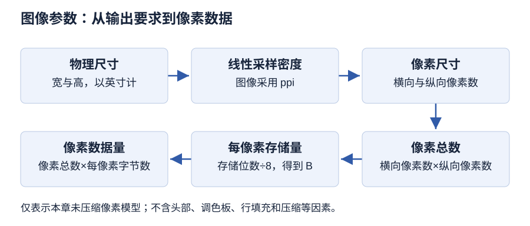

# 第 4 章 图形图像处理技术

> 大纲定位：刘成明、石磊主编《多媒体技术及应用（第三版）》（清华大学出版社，2021 年），对应江苏省高等教育自学考试 13511《多媒体技术与应用》大纲（江南大学编，2024 年）。以下讲解与练习独立编写，按该版范围学习。

!!! note "版本与来源"

    本章依据《多媒体技术及应用（第三版）》首轮重点校对稿整理，成书尚未逐字终校；软件步骤按教材所用版本描述，未在本机实测。原书疑点见[版本与勘误](../../errata.md)。

## 复习导航

| 复习条目 | 层次 | 讲解 | 自编练习 |
| --- | --- | --- | --- |
| 图形与图像 | 识记、领会 | [第 1 节](#s1) | 1 |
| 分辨率、尺寸和数据量 | 识记 | [第 2 节](#s2) | 2、6 |
| 颜色的表达 | 识记、领会、简单应用 | [第 3 节](#s3) | 1、5 |
| 文件格式的选择 | 识记 | [第 4 节](#s4) | 3 |
| 公式、条件与步骤 | 识记、领会、简单应用、综合应用 | [第 5 节](#s5) | 2、3、4、5、6 |

## 1 图形与图像 {#s1}

图形处理又叫计算机图形学，研究二维、三维图形的矢量表示、生成、处理与输出。点、线、面等数学模型存进计算机，经几何变换、拟合、着色和显示表现物体和场景。图形由人设计构造，来源主观：给出几何参数就能生成，结构是参数图或矢量图。

图像处理面对位图：数字化、压缩、存储、传输。图像按位图存取，压缩减小数据量，输出时再解压。它由摄像机、扫描仪等设备输入，来源是客观景物，结构是位图（点阵图），每个像素记自己的颜色。

区别看五方面：来源（主观设计／客观景物）、目的（构造图形／分析图像）、过程（几何参数生成／提取模型）、用途（设计、仿真、模拟／模式识别、景物分析、计算机视觉）、结构（参数图、矢量图／位图、点阵图）。两者都用光栅显示器显示，可以结合使用；图形处理专业性强，本章不展开。

## 2 分辨率、尺寸和数据量 {#s2}

| 概念 | 教材定义要点 | 单位或表示方式 |
| --- | --- | --- |
| 图像分辨率 | 单位图像线性尺寸中所包含的像素数目 | 像素/英寸，ppi |
| 显示分辨率 | 单位长度显示的像素或点；也指屏幕横纵像素数 | dpi（点/英寸）；PC 常见 96 dpi |
| 打印分辨率 | 每英寸油墨点数；原书另作每平方英寸网点数 | dpi |
| 扫描分辨率 | 每英寸扫描所得到的点，数值越大越逼真 | dpi |
| 像素尺寸 | 图像横向、纵向的像素数量 | 宽 × 高，像素 |
| 输出尺寸 | 给定输出分辨率下的物理尺寸 | 英寸等长度单位 |

原书打印分辨率一段既写“每英寸产生的油墨点数”，又写“每平方英寸印刷的网点数”，两种口径并存，属原书疑点；本笔记按线性单位 dpi 计算。

### 从用途反查参数

屏幕图像满足 72 ppi 或 96 ppi；打印输出要 150 ppi 或 300 ppi，低了有颗粒和锯齿。屏幕的显示分辨率由屏幕尺寸和像素设置决定。ppi 是图像采样密度，dpi 是设备每英寸形成的点，印刷网点与屏幕像素不同，不能直接替换。

同一批像素按更低 ppi 输出，纸面范围更大，细节没增加；把低清图的分辨率数值调高，像素数没变，品质也不会提高。重新采样另算，算题要说明像素数是否不变。

## 3 颜色的表达 {#s3}

彩色光能由红、绿、蓝按比例配出，也能分解成三色，这是三基色原理；三色必须相互独立。显示器用加色法：红加绿得黄，红加蓝得紫（品红），绿加蓝得青，三色相加得白；青、品红、黄是红、绿、蓝的补色。

色彩用亮度、色相、饱和度描述，称三要素。亮度是光作用于人眼引起的明亮感觉，与发光强度有关。色相是彩色感觉的种类，由波长决定。饱和度是纯度，也叫彩度、浓度，指掺入白光的程度，掺白光越多越浅。色相与饱和度合称色度：亮度管明暗，色度管类别与深浅。HSB 模式也用这三项，有的考题把亮度叫“明度”。

像素颜色用二进制记录，二进制位数就是颜色深度，它决定颜色最大数目。1 位只有黑白两色；8 位为 1 字节、256 种颜色；24 位为 3 字节、16777216 种颜色，24 位及以上称真彩色；32 位用 R、G、B 各 1 字节，另 1 字节记透明度等。常见深度为 1、4、8、16、24、32 位。

| 模式 | 组成或特点 | 教材用途线索 |
| --- | --- | --- |
| RGB | 红、绿、蓝相加（加色法） | 显示器显示；输出前转成 RGB |
| HSB | 色相、饱和度、亮度 | 按人眼特征描述颜色 |
| CMY / CMYK | 青、品红、黄相减；印刷另加黑色 K | 彩色打印与印刷 |
| Lab | 亮度 L、色度 a、b；颜色最多 | 颜色描述与转换 |
| 索引颜色 | 调色板加颜色索引，最多 256 色 | 限制颜色数减小文件；网页常用 |
| 位图模式 | 黑白两色，每像素 1 位，0 黑 1 白 | 文字识别；同样像素数下数据量最小 |
| 灰度模式 | 单一色相，最多 256 级 | 只留亮度，转换丢掉彩色 |

RGB 的配色方程为 $F=r[R]+g[G]+b[B]$；HSB 的色相在 0°～360° 色轮上度量；K 取自 Black 的末字母，因为 B 已表示蓝；Lab 的亮度 L 取 0～100，与设备无关；灰度按 0 黑、255 白计量。

“位图图像”是点阵结构，“位图模式”是黑白模式，两词不能互换。灰度图转回彩色只是重新套彩色，原始颜色不会恢复，转灰度前留原件。同一幅图按不同模式保存，体积不同：位图 1 位、灰度 8 位、RGB 24 位；RGB 比 CMYK 小、命令和滤镜都能用，CMYK 更大、部分滤镜受限，只在打印时转换。

## 4 文件格式的选择 {#s4}

图像文件分图像说明和图像数据：说明记宽、高、格式、颜色深度、调色板、压缩方式；数据记每个像素的颜色，怎么放由文件格式决定。选格式看用途和格式对数据类型的要求。

| 格式 | 本章复习要点 | 选择线索 |
| --- | --- | --- |
| BMP | 位映射、不压缩；1/4/8/24 位 | 要保留原始像素、不在意体积 |
| GIF | LZW 压缩；256 色，可动画、透明 | 网络图像；网页标准格式之一 |
| JPEG | 有损压缩；品质与压缩级别可调 | 最后一步输出，编辑过程另存 PSD |
| TIFF | 可压缩；支持 1～8/24/32/48 位 | 扫描与页面排版 |
| PSD | 记录图层、通道、蒙版；不压缩 | 保留可继续编辑的工作稿 |
| PNG | 无损压缩，支持透明 | 网络图像与透明背景 |

BMP 是 Bit Map 缩写，Windows 的标准格式；GIF 由 CompuServe 制定；TIFF 是标记图像文件格式，常用标识 TIF，32 位对应 CMYK、48 位对应 RGB；PSD 是 Photoshop 专有格式，其他软件支持较少，图层多时体积大；PNG 是 Portable Network Graphics 的缩写。

BMP、GIF、JPEG、TIFF、PSD、PNG 都以位图方式保存图像，常用扩展名依次为 .bmp、.gif、.jpg（或 .jpeg）、.tif、.psd、.png。选格式看四件事：还要不要编辑、要不要透明或动画、允不允许有损、目标软件认不认。像素数据量公式只管未压缩像素，压缩文件字节数另算。

## 5 公式、条件与步骤 {#s5}

### 未压缩像素数据量

未压缩像素数据量的计算式为

\[
B_{\text{pixels}}=H\times W\times C/8
\]

其中 H、W 为高和宽的像素数量，C 为颜色深度，即每像素存储位数，结果为字节 B。自编约定：只算均匀位深的未压缩像素数据，不含文件头、调色板、行填充、元数据等开销；题目给出额外存储分量时先计入 C。练习用 KiB 表示 1024 B。

自编算例：设缓存保存 800 × 600 像素，每像素 24 位，忽略上述开销。

1. 每像素占用：24 bit ÷ 8 = 3 B。
2. 像素总数：800 × 600 = 480000。
3. 采样数据：480000 × 3 = 1440000 B。
4. 换算：1440000 ÷ 1024 = 1406.25 KiB。

每一步都由给定数据推出。宽、高翻倍而位深不变，像素数和数据量变四倍；位深由 24 位改 32 位，数据量按 32/24 变。压缩文件另看编码。

### 输出尺寸与采样密度

由图像分辨率定义可推：横向像素数 = 输出宽度（英寸）× 分辨率（ppi），纵向同理。例：2 × 3 英寸、300 ppi 对应 600 × 900 像素；24 位未压缩数据量为 1620000 B。这里只算给定输出条件所需像素，不代表提高低清图 ppi 能补回细节。

### 获取与扫描

获取有两种途径。一种用设备做模数转换：扫描仪扫照片和印刷品；数码相机经串行接口或 USB 送计算机；数码摄像机影像走 IEEE1394、图片走 USB。另一种从数字图像库、网络获取或截图：图库多用 PCD（Kodak Photo-CD）和 JPEG；下载要确认授权、付费和注册；记录操作用截图软件把屏幕内容保存下来。

扫描把纸质印刷品变成数字图像，靠扫描仪和软件。驱动由厂家提供，有六项：扫描模式（彩色、灰度等，选“彩色 24 位”得彩色图）；分辨率（dpi 越大越清楚、数据量越大）；扫描参数（可调对比度、亮度、颜色饱和度，以及 RGB 三色比例，颜色分布规律用来校正设备偏差）；预览（看摆放位置，灰度即可）；扫描范围（虚线框内）；正式扫描（先核对参数，扫完再保存）。

自编步骤卡：调用扫描驱动程序 → 选扫描模式 → 设分辨率 → 调扫描参数 → 预览 → 确定扫描范围 → 正式扫描并保存。

数码拍摄用相机或摄像机直接拍自然景物，直观、环节少，拍完就是数字文件，可直接打印或经电缆送计算机。相机关键元件是 CCD（电荷耦合器件）光敏元件，也有机型用 CMOS；CCD 先把影像转成电信号，再译码成数字信号。主要指标是像素数、分辨率和存储容量；镜头和焦距也影响成像。

| 环节 | 要点 |
| --- | --- |
| 拍摄前准备 | 压缩、闪光、白色平衡、对焦、像素、曝光 |
| 拍摄过程 | 取景、构图、对焦、释放快门；取景器分四种 |
| 接口与传送 | 串行通信口或 USB；首次要装驱动 |

拍摄前在液晶屏上设压缩倍率、闪光、白色平衡、对焦、像素和曝光方式。闪光有自动、消除红眼、关闭、强制四种，默认自动。拍摄顺序和轻便相机差不多：取景、构图、对焦、按快门。取景方式四种：光学平视、单反式光学、彩色液晶屏电子式、辅助式液晶屏；光学平视有视差，距离不到 1 米时取景与照片可能对不上。拍完用电缆连计算机传数据，多数相机用 USB 口，首次使用装驱动。

成书按品牌和元件介绍数码相机，没有单列机身类型的分类表；大纲要求的“数码相机类型”一项缺少成书依据。

网络取图以搜索引擎为例：输入关键词，点开图片放大看，需要时“图片另存为”。截图以 FastStone Capture（FSCapture）为例：能抓活动窗口、指定窗口或控件、矩形区域、封闭自定义区域、全屏和滚动整页。截好的图可存文件，也可送剪贴板、打印机、邮件、Word 或 PowerPoint；格式有 BMP、GIF、JPEG、PCX、PNG 等。

### Photoshop 2020 处理步骤卡

图像处理是给图像信息做加工，满足视觉心理和实际用途；用计算机做就是数字图像处理，分改内容、优化效果、加特殊效果三块。改内容有选择、裁剪、旋转、缩放、修改和图层叠加，还能加文字和图形；优化效果做增强、滤噪、校畸、锐化、恢复；特效靠滤镜。Photoshop 由 Adobe 开发。

| 任务 | 教材步骤摘要 |
| --- | --- |
| 调整大小和格式 | 按比例改像素尺寸，另存 JPEG 设品质 |
| 裁剪图片 | 裁剪工具拖框，确认后裁掉框外 |
| 特效文字 | 文字加图层样式（投影、光泽、图案） |
| 调整图像色彩 | “色阶”调高光与暗调，改善偏暗 |
| 拼接图像 | 另一图选框拖入，变换、蒙版、画笔、仿制图章 |
| 滤镜特效 | 点状化、动感模糊、去色，混合模式做下雪 |

具体操作时，调整大小在“图像大小”对话框里按比例改宽度或高度，另存 JPEG 还要设品质；裁剪框拖好后按 Enter 或双击确认；拼接先画矩形选框，把选区拖到另一幅图，再合成。

可编辑文件另存 PSD，保留图层、通道和蒙版。图层像透明纸，叠起来构成完整图像，改一层不影响其他层；通道存颜色信息、选区和蒙版，分颜色、专色和 Alpha 通道，最多 24 个，越多文件越大；路径可闭合可开放，能在“路径”面板填充、描边或转选区。Photoshop 支持位图、灰度、RGB、CMYK、HSB、Lab：存图一般用 RGB，文件小、命令和滤镜都能用；CMYK 文件大、部分滤镜不能用，只在打印时转换。

右下角带三角的工具按住 2～3 秒展开隐藏工具。椭圆选框工具拖动时按 Shift 得圆形选区；形状工具组有矩形、圆角矩形、椭圆、多边形、直线和自定形状，椭圆工具拖动生成椭圆，按 Shift 约束为正圆。减淡、加深、海绵工具让区域变亮、变暗、改饱和度；模糊、锐化、涂抹工具让划过处变模糊、变清晰、沿方向涂抹。仿制图章用图像样本绘画，裁剪工具裁掉范围外画面。

操作时先弄清选中的是图像还是蒙版，选错对象调整会落在别处。交付物包括原素材、可编辑文件和输出副本，口述步骤代替不了工程和输出。

### 自编操作任务：修订社区活动说明图

**环境与状态：** 按 Photoshop 2020 的教材功能组织。准备自摄照片和自行撰写的活动名称，保留原件。目录自定为 `originals/`、`work/`、`output/`，分别保存原件、可编辑稿和交付副本；这些目录是本任务的组织约定。

**任务一：裁切与尺寸。** 先定要保留的主体和输出横纵比例，打开副本，检查像素尺寸和颜色模式。用裁剪工具确定保留范围，再按用途调整像素尺寸；每次改动后检查主体是否被切断、比例是否拉伸。保存分层工作稿，另存输出副本，重新打开检查尺寸。裁切控制保留范围，缩放控制像素尺寸，只改 ppi 数字并不等于两项都已完成。

**任务二：可修改的标题。** 在独立文字图层输入标题，调整字体、大小及位置，用图层样式观察效果。保存后重新打开，改一个字再保存；若只能改整幅平面像素而改不了文字，就回查保存格式与图层状态。检查标题在实际输出大小下是否清晰、是否遮挡照片主体。

**任务三：曝光与合成。** 在工作副本中比较调整前后的色阶；另将一份自制图形或自摄局部放入独立图层，以选区、蒙版和颜色调整处理衔接。每次操作前确认选中的是图像还是蒙版，检查边缘、主体细节及文字可读性。保留可返工版本，再生成交付副本。

| 交付物 | 核对内容 |
| --- | --- |
| 原素材 | 来源、原始尺寸、未覆盖的原件 |
| 可编辑稿 | 图层、文字、蒙版、重新打开结果 |
| 输出副本 | 尺寸、格式、显示与目标用途 |
| 操作记录 | 版本、初始状态、步骤、预期与实际 |

操作记录要写明日期与未解决的问题；没有工程文件和检查记录时，只登记任务设计完成。

## 本章小结

- 图形是设计构造的参数图、矢量图，图像是设备采集的位图、点阵图；来源、目的、过程、用途和结构可区分。
- 图像分辨率用 ppi，显示和打印用 dpi；打印分辨率的原书表述有两种口径，按线性单位处理。
- 颜色三要素是亮度、色相、饱和度；颜色深度决定颜色最大数目，24 位及以上为真彩色；各模式用途不同。
- 未压缩像素数据量按 B=H×W×C/8 计算，不含文件头等开销；图像靠扫描、拍摄、网络和截图获取，Photoshop 用图层、通道、蒙版编辑。

## 自编练习

**1. 展馆要同时制作可反复放大的标志和包含纹理的实景照片。为两类素材分别选择表示方式，并说明显示用颜色模式与印刷用模式为何不能混成同一项要求。**

考点：第 1、3 节；层次：识记、领会。

**答案：** 标志适合以几何对象及属性组织，便于改变尺寸；照片适合按像素保存色调与纹理。RGB 围绕显示光的组合，CMY/CMYK 围绕印刷着色。表示方式回答如何描述图像，颜色模式回答如何组织颜色，两者不能合成一项。

**2. 展馆屏幕使用1920×1080像素的24位图像。仅计算一帧不压缩像素缓冲区，不计文件头、调色板和行填充；求字节数及KiB，并说明为什么不能据此断定下载文件大小。**

考点：第 2、5 节；层次：识记。

**答案：** 每像素24÷8=3字节，缓冲区为1920×1080×3=6220800字节，即6075 KiB。这里的KiB以1024字节计。图像文件还受到压缩、文件结构和附加信息影响；像素缓冲区的大小不是所有格式的磁盘文件大小。

**3. 同事把带透明背景的按钮导出成只保留平面像素的交付文件，同时删去了分层工作稿。说明此交付在后续改字、调整图层和恢复透明效果时留下什么问题。**

考点：第 4、5 节；层次：识记、领会。

**答案：** 交付格式与可编辑工作稿用途不同。平面像素文件替代不了图层、选区等对象关系；应分别保留可修改的源文件和面向使用环境的输出文件，并核对透明信息是否被目标格式保留。

**4. 为一张偏暗、背景杂乱的活动照片拟定处理检查单，要求保留主体、统一展板尺寸，并能在修改错误时回到原素材。无需写菜单名称。**

考点：第 5 节；层次：综合应用。

**答案：** 先备份原素材并检查尺寸与用途，再用选区或裁切定主体，调整亮度和色彩，按需要清理背景并组织图层，最后核对像素尺寸和输出格式。保留工作稿后另存交付文件，复查是否误切主体和显示效果；这是设计任务，不代表已完成实操。

**5. 同一活动需要屏幕说明图、黑白印刷校样和可继续改字的工作稿。比较 RGB、灰度与保存图层的工作稿分别解决什么问题。先做灰度校样再转回 RGB，能否取得原来的彩色照片？**

考点：第 3、5 节；层次：领会、简单应用。

**答案：** RGB 用于描述显示所需的颜色，灰度用于只保留亮度层次的校样；工作稿保存图层和文字关系，便于继续改。颜色模式与保存编辑结构是两项要求，可同时记录。灰度转换丢掉的颜色不会因再次选 RGB 而恢复，应回到保留的彩色原件或可返工版本。

**6. 学习拓展：一幅 2400×1600 像素、24 位的图像，不重新采样，按 200 ppi 输出。求物理尺寸与未压缩像素数据量，忽略文件结构开销。改成 100 ppi 后，这两个结果各如何变化？**

考点：第 2、5 节；层次：简单应用。

**答案：** 宽为 2400÷200=12 英寸，高为 1600÷200=8 英寸。每像素 24÷8=3 B，数据量为 2400×1600×3=11520000 B，即 11250 KiB。改为 100 ppi 后输出为 24×16 英寸；题设像素数和位深未变，像素数据量不变。本题是从定义形成的自编推算，不将设备 dpi 代入 ppi。
