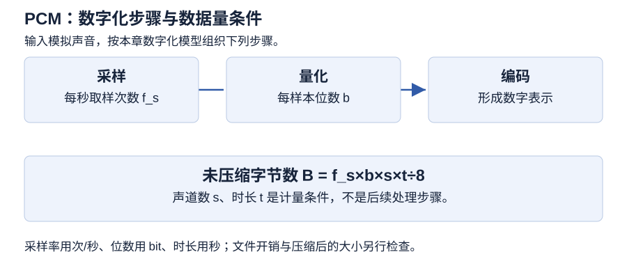

# 第 5 章 音频处理技术

> 大纲定位：刘成明、石磊主编《多媒体技术及应用（第三版）》（清华大学出版社，2021 年），对应江苏省高等教育自学考试 13511《多媒体技术与应用》大纲（江南大学编，2024 年）。

本章考点与必背清单：[第 5 章 音频处理技术 · 应试导航](exam/05.md)

## 学习导航

| 复习条目 | 层次 | 讲解 | 练习 |
| --- | --- | --- | --- |
| 声音和音频 | 识记 | [第 1 节](#s1) | 1 |
| 数字化过程 | 识记、领会 | [第 2 节](#s2) | 1、2、6 |
| 未压缩 PCM 数据量 | 领会 | [第 3 节](#s3) | 2、6 |
| 编码与文件格式 | 识记、领会 | [第 4 节](#s4) | 3 |
| 音频工具的用途 | 识记 | [第 5 节](#s5) | 3 |
| 采集与软件操作 | 识记、领会、综合应用 | [第 6 节](#s6) | 4、5 |

## 1 声音和音频 {#s1}

**必背：** 声音按频率分次声、音频、超音频 3 类，音频为 20 Hz～20 kHz；振幅反映音量即响度，频率反映音高，音色用于辨别声源；声音强度用 dB 表示，按对数标尺计，功率提高 4 倍只加 6 dB。

物体振动产生压力波，传到耳膜被人感觉到，就是声音。声波用振幅 A、周期 T 和频率 f 描述，频率是周期的倒数：$f=1/T$。振幅是波形的最大位移，反映音量即响度；频率以 Hz 为单位，反映音高。声音按频率分三类：低于 20 Hz 是次声，20 Hz 至 20 kHz 是音频，高于 20 kHz 是超音频（或超声）。振幅和频率不变的声音为纯音，语音、乐声多是复音，由基频和谐音组成；基频决定音调，音色用于辨别声源。

声音的强度用分贝（dB）表示，dB 值按对数标尺计算：输出功率提高到 4 倍，dB 值只增加约 6；提高到 100 倍，也只增加 20。dB 值的变化与功率倍数成对数关系，不能按倍数线性换算。

多媒体计算机的音频可分波形音频、CD 音频、MIDI 音乐三类。音频是存储在计算机里的声音，由声卡采集、播放并保存为文件。波形音频由外部声源数字化采集得到，可再编辑、压缩、存储和播放；CD 音频存储在音乐 CD 光盘中，可通过 CD-ROM 驱动器读取；MIDI 音乐存的是符号化的乐谱，播放时靠音乐合成器转成声音。

## 2 数字化过程 {#s2}

**必背：** 数字化分采样、量化、编码 3 个环节；采样率按奈奎斯特定理不低于信号最高频率的 2 倍，量化位数 8 位对应 256 级、16 位对应 65536 级；声道分单声道、双声道与多声道。

| 环节 | 处理对象 | 关键点 |
| --- | --- | --- |
| 采样 | 时间连续的波形 | 每秒取样次数为采样频率 $f_s$ |
| 量化 | 采样点幅值 | 位数影响离散量化级数 |
| 编码 | 量化后数据 | 形成可存储或传输的数字音频表示 |

采样是每隔一段时间读取一次声音的幅度，使声音在时间上离散。采样频率是每秒钟抽取声波幅度样本的次数，单位是 kHz。按奈奎斯特定理，采样率至少要达到信号最高频率的 2 倍（$f_s\geq 2f_{max}$），离散后的数据才足以还原原来的波形。音频频率在 20 Hz～20 kHz，据此采样率应在 40 kHz 左右。8 kHz、11.025 kHz、16 kHz、22.05 kHz、37.8 kHz、44.1 kHz（CD 音质）、48 kHz 都是常用采样率。

量化把采样得到的幅度转换为数字值，使声音在幅度上离散。量化位数决定一个采样点能表示多大的数据范围；位数越多，量化结果越贴近原来的波形。常用 8 位、16 位和 24 位。语音编码可用 8 位，对应 256 个量化级；音频可用 16 位，对应 65,536 个量化级。量化级决定声音的动态范围，16 位量化级已能覆盖从极细微声音到巨大噪声的范围。量化时采样值四舍五入到最近整数；幅度超出范围时波形顶部和底部会被削去，称为削峰，可能造成严重失真。

采样率、量化位数和声道数各管一个维度：采样率决定单位时间取多少个样本，量化位数决定幅值能分多少级，声道数决定并行保存几个通道。三者共同决定数据量，音质还取决于音源、电平和后期处理。记录声音时，每次生成一个声波数据为单声道，生成两个为双声道（立体声），生成两个以上为多声道（环绕立体声）。

## 3 未压缩 PCM 数据量 {#s3}

**必背：** 未压缩 PCM 数据量 $B=f_s\times b\times s\times t/8$，$f_s$ 以 kHz 给出时先乘 1000，$b$ 为量化位数，$s$ 为声道数；此式只计未压缩采样数据，不计文件头与封装开销。

计算式：

$$R_{bit}=f_s\times b\times s\quad(\text{bit/s})$$

$$R_{byte}=\frac{f_s\times b\times s}{8}\quad(\text{B/s})$$

$$B=\frac{f_s\times b\times s\times t}{8}\quad(\text{B})$$

$f_s$ 用 samples/s，$b$ 为 bit/sample，$s$ 为声道数，$t$ 用秒；采样率以 kHz 给出时先乘 1000。此式只计未压缩采样数据，不计文件头、元数据、块对齐、压缩或封装开销。KB 与 KiB 的换算不同：$1\text{ KB}=1000\text{ B}$，$1\text{ KiB}=1024\text{ B}$，计算时注明用哪一种。

- 换一组参数：10 秒、48 kHz、24 bit、双声道，结果为 2,880,000 B，即 2.88 MB 或 2,812.5 KiB。

原书把采样率（kHz）、量化位数和声道数相乘后除以 8，结果标为 KB/s；随后的 10 秒例算得到 220,500，仍标 KB/s。这个数值是 10 秒内的字节数，不是每秒 KB。表 5-2 前两行印作“5.5Hz”，同表还有“单声道生源”的字样，这些都是原书自身的不一致，照录不改。原书另有 CD 音质每秒约 172 KB 的说法；44.1 kHz、16 bit、双声道合 176,400 B/s，约合 172.27 KiB/s，原书未说明 KB 的换算定义。

### 推算：预算能保存多久

设每秒 24000 次采样、16 位、单声道，仅有 1536000 B 可保存未压缩采样数据；不计其他开销。

1. 位率为 24000×16×1=384000 bit/s。
2. 字节率为 384000÷8=48000 B/s。
3. 可用时长为 1536000÷48000=32 s。
4. 若保持采样率和位数，改为双声道，字节率为 96000 B/s，可用时长为 16 s。

反查时将时长乘回字节率，两种方案均得到所设预算。容量、时间和数据率的单位必须相配；MP3 等已编码文件不能套用采样公式。

## 4 编码与文件格式 {#s4}

**必背：** 音频压缩编码分无损与有损两类，有损再分波形编码、参数编码、混合编码；WAV 不压缩、音质最好，MP3 是有损的 MPEG-1 Layer3、压缩率 10:1～12:1，MIDI 记录演奏信息而不记波形。

采样量化后的数据量很大，压缩编码后才能存储或传输，播放时再由解码器还原。压缩要去除采样数据中的冗余，同时把音质控制在允许范围内；音频数据压缩编码分无损压缩和有损压缩两大类。无损压缩主要是各种熵编码；有损压缩分波形编码、参数编码和混合编码。波形编码让编码信号尽量贴合原波形，适应性强、音质好，适合高质量音频，但压缩比不大。参数编码只传送模型参数与激励信息，接收端再据此合成声音；压缩率很高，代价是运算量大、保真度有限，常用于电话音质的一般语音。混合编码介于两者之间，集中两种方法的优点，能在较低码率上得到较高音质。

| 格式 | 特点 | 用途与注意 |
| --- | --- | --- |
| WAV | 微软波形格式，Windows 标准，不压缩 | 音质最好，体积最大；常在其基础上再编码 |
| MP3 | MPEG-1 音频第三层（Layer3） | 有损压缩；体积小，适合网络与便携 |
| WMA | 微软流式压缩格式，压缩率约 18:1 | 支持音频流，适合在线播放 |
| MIDI | 记录演奏消息，不记波形 | 文件很小，播放质量取决于 MIDI 设备 |
| CD-DA | 音乐 CD 标准音频，数据量大 | 音质好；需 CD-ROM 读取或抓轨 |
| AU、RealAudio、AIFF | 三个格式 | 按来源与用途区分 |

MP3 的压缩率约 10:1～12:1；AU 来自 Sun，面向 UNIX；RealAudio 是流式音频；AIFF 由 Apple 开发，Macintosh 支持。

## 5 音频工具的用途 {#s5}

**必背：** Audition 做录制混合编辑与修复，GoldWave 做编辑播放录制转换并提取音轨，All Editor 提供多种效果，Total Recorder 用虚拟声卡截取程序输出，格式工厂做格式转换。

常用的音频工具按任务分成专业编辑与混音、录音与截取、格式转换几类：

| 软件 | 主要用途 |
| --- | --- |
| Adobe Audition | 录制、混合、编辑、控制和修复音频 |
| GoldWave | 编辑、播放、录制、转换；提取光盘或视频音轨 |
| All Editor | 录音、剪贴混合、效果处理；含淡入淡出等 |
| Total Recorder | 虚拟声卡截取程序输出；硬/软件与网络音源 |
| 格式工厂 | 转 MP3/WMA/FLAC，提取光盘音频 |

原书称 Total Recorder 的截取理论上不会失真。

## 6 采集与软件操作 {#s6}

**必背：** 采集先定采样参数、再检测输入强度、然后录音；一段音频只能有一个采样率且录制中不能改；降噪先捕捉噪声样本再处理目标段，处理强度越高人声失真可能越大。

采集前先按用途选好采样参数：太低音质差，太高数据量巨大；一段音频只能有一个采样率，录制中不能改，要在音质和数据量之间取平衡。录音前还要检查输入强度：太低则音量小、噪声突出；太高则超出允许范围而失真。数字音频还可以从 CD、VCD、DVD 中抓取音轨，或用电子合成音乐（MIDI）的方式获得。

抓轨可用 Windows Media Player、WaveLab 等工具；Exact Audio Copy（EAC）是常用的无损抓轨工具，用多种技术提高抓取质量。电子合成音乐即 MIDI：记录键名、力度、时间长短等演奏信息，不记录波形；用带合成器的声卡、MIDI 键盘和音序器采集编辑指令，再由音乐合成器生成波形。声卡播放 MIDI 常用 FM 合成和波表合成，波表使用真实乐器采样，效果一般好于 FM 合成。

Audition 的入门操作包括新建音频文件时选择采样率（默认 48000 Hz）、录音、在多轨会话中分轨，以及导入素材采样率与会话不一致时按提示自动匹配。降噪在单轨编辑视图里做：先在有声段落处捕捉噪声样本，再选中要处理的音频段，用降噪窗口调节参数线；处理强度越高声音越干净，人声失真的可能也越大。整个流程可归纳为导入或录制、检查电平、剪辑、多轨安排、效果处理和导出。

### 操作任务：分段旁白与背景声

**环境与状态：** 以 Audition 2020 的录音、多轨和降噪功能组织。素材为自行录制的分段介绍和自行制作的背景声。先建原件、工作稿和输出目录，写明采样率、位数、声道与保存位置。

1. **试录与留原件。** 确认输入设备和通道，先试录正常发声及停顿，试听是否过轻、过强或出现失真；调整输入后再正式录制，原录音单独保存。后期降噪不代替录音前的电平检查。
2. **组织与衔接。** 保留工作副本，去掉误录和无关片段；逐一试听段首、段尾和连接处，检查是否切掉字音。记录每段的用途与位置，再检查全段顺序。
3. **多轨安排。** 新建多轨会话，导入旁白及背景声，分别安排轨道，检查起止和重叠。若素材采样率与会话不一致，记录提示、处理选择和结果；不把软件出现提示本身记作匹配完成。
4. **噪声处理。** 在工作副本中选取不含所需语音的噪声片段作为样本，再对目标段尝试降噪，比较处理前后的背景和人声。若人声受损，返回处理前状态调整；没有合适样本时记录条件不足，不把语音当噪声样本。
5. **保存与复听。** 保存可返工的会话、关联素材和处理记录，另存播放交付物。关闭编辑视图后独立打开输出文件，试听整段、衔接和音量，核对时长与声音是否完整。

验收记录包含环境、输入参数、素材位置、操作、预期、实际、工程与输出位置、日期和未决问题。只保存一份播放文件，无法证明会话及关联素材能继续编辑；只保存会话，也没有证明交付音频可独立播放。

## 本章小结

- 响度、音高和音色描述听觉特征，采样率、量化位数和声道数描述数字表示，两组参数不能互相代替。
- 未压缩 PCM 字节数=采样率×位数×声道×秒数÷8，先换算 kHz，再区分 B、MB 与 KiB；MIDI 消息不等同波形采样。
- 采集前试录并检查输入电平，编辑后核对衔接与导出结果；单位标注不一致时，按字节数与时长反算核对。

## 练习

**1. 讲解员说话更响，是否意味着声音频率一定更高？为录音单列响度、音高、音色和数字化参数，解释为什么这些栏目不能互相代替。**

考点：第 1、2 节；层次：识记、领会。

**答案：** 响度、音高和音色描述不同听觉特征；提高响度不能据此推出频率升高。采样频率描述时间上的取样密度，量化位数描述幅度表示的级数，声道描述通道数。声音特征与数字表示参数要分开列。

**2. 导览系统保存45秒、32000次/秒、16位、单声道的未压缩PCM。仅计采样数据，求所需字节数；若只知道同长度MP3文件的扩展名，是否能照此求其大小？**

考点：第 2、3 节；层次：领会。

**答案：** PCM采样数据为32000×16×1×45÷8=2880000字节，即2812.5 KiB。压缩音频不能只凭扩展名套用这个结果；还需知道编码后的码率、时长及相应开销。公式中的采样频率、位数与声道条件缺一不可。

**3. 项目收到一份WAV、一份MIDI和一段待录制的访谈。如何分别安排检查和处理工具，避免把音符指令文件当成已经录好的声音波形？**

考点：第 4、5 节；层次：识记、领会。

**答案：** 先确认文件内容和编码，不能只按名称推断。WAV属于声音文件格式的讨论范围；MIDI用于描述演奏相关信息，其内容不能直接等同于录音波形。访谈要先采集，再做剪辑和效果处理；工具应按录音、编辑、合成或格式转换的任务选用。

**4. 为导览旁白设计录音至交付的工作流程，要求去除无关片段、保留可返工版本，并检查多段旁白衔接。给出检查点即可。**

考点：第 6 节；层次：综合应用。

**答案：** 先明确设备、输入通道和录音参数，试录确认后采集素材；保留原录音，再剪除无关片段并处理衔接，按需要做效果和音量调整。保存编辑项目或工作稿，另行导出交付音频，试听头尾、连接点和整段结果。Audition 的菜单名称和操作步骤随版本变化，动手时按对应版本的界面核对。

**5. 试录时声音失真，操作员仍直接录完，再把整段人声选作噪声样本，准备以最大处理强度补救。指出录音检查和降噪处理各应先确认什么。**

考点：第 6 节；层次：识记、领会。

**答案：** 先核对输入设备、通道和电平，调整后重新试录，不能把有问题的采集链留给降噪补救。噪声样本应对应要处理的背景噪声，不能将所需人声整体当作噪声。效果设置还要通过前后试听判断，处理强度更大并不保证人声更完整；保存原件才能比较或返工。

**6. 固定保存 1536000 B 的未压缩 PCM，参数为 24000 次/秒、16 位、单声道。有人用“容量÷384000”得到秒数，错在哪里？正确计算后，解释改双声道为何会改变可存时长。**

考点：第 2、3 节；层次：领会。

**答案：** 384000 是 bit/s，预算是 B，不能直接相除求秒。先除以 8 得到 48000 B/s，再计算 1536000÷48000=32 s。双声道的每秒数据量变为两倍，同预算只能保存 16 s；这是保持其他条件不变的采样数据推算，未计文件结构开销。
