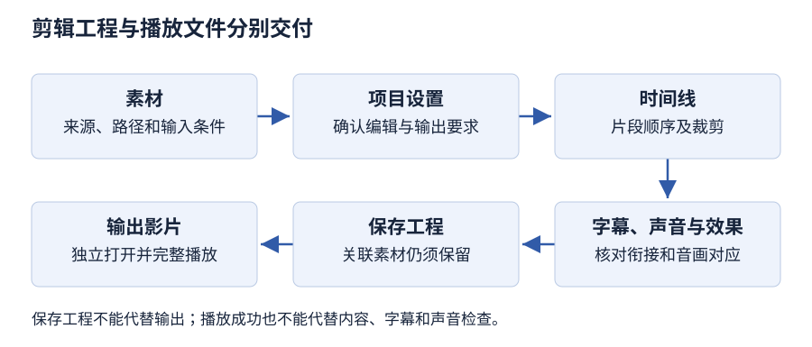

# 第 6 章 视频处理技术

> 大纲定位：刘成明、石磊主编《多媒体技术及应用（第三版）》（清华大学出版社，2021 年），对应江苏省高等教育自学考试 13511《多媒体技术与应用》大纲（江南大学编，2024 年）。

本章考点与必背清单：[第 6 章 视频处理技术 · 应试导航](exam/06.md)

## 学习导航

| 复习条目 | 层次 | 讲解 | 练习 |
| --- | --- | --- | --- |
| 视频与信号类型 | 识记 | [第 1 节](#s1) | 1 |
| 数字视频的特点与编辑对象 | 识记、领会 | [第 2 节](#s2) | 1、2 |
| 编辑、压缩与格式 | 识记、领会 | [第 3 节](#s3) | 2、3、5 |
| 采集、转换与 Premiere 流程 | 识记、领会、简单应用、综合应用 | [第 4 节](#s4) | 3、4、5 |

## 1 视频与信号类型 {#s1}

**必背：** 模拟视频四种信号类型是复合、分量、分离（Y/C）、射频，不含伴音的是复合；三种制式按帧频、场频、行数成组背，NTSC 30 f/s 配 525 行、PAL 与 SECAM 25 f/s 配 625 行。

视频是一串静止画面（图像帧）配着同步的音频顺着时间轴往下走，画面连续变化，所以又叫运动图像；本质上它是随时间变化的一组动态图像，可写成 $v(x,y,t)$，其中 $(x,y)$ 表示空间位置，$t$ 表示时间。

模拟视频从录制、存放、处理到传输，一路都用连续变化的模拟信号，连介质、设备和网络也属于模拟体系。这类信号由亮度、色度、复合同步和伴音四部分组成；为了适应不同的传输与连接环境，分成四种信号类型：复合视频信号把亮度、色差和定时信号合成一路，不含伴音，带宽较窄，水平分辨率约 240 线；分量视频信号把每个基色分量作为独立信号，可用 R、G、B 或亮度-色差形式表示，需要较宽的带宽和同步信号，VGA 输出即分量形式；分离视频信号（Y/C）把亮度 Y 和色差 C 分开，是复合与分量之间的折中，可减少交叉干扰并提高亮度带宽；射频信号把含伴音的全电视信号调制成射频，每个信号占用一个频道，用于远距离传输。

模拟视频标准也称电视制式，最常用的是 NTSC、PAL、SECAM 三种，区别主要在帧频（场频）、信号带宽、载频和色彩空间转换关系。教材表 6-1 列出主要参数：NTSC 帧频 30 f/s、525 行/帧、场频 59.94 Hz，实际帧频为 29.97 Hz；PAL 帧频 25 f/s、625 行/帧、场频 50 Hz；SECAM 同为 25 f/s、625 行、50 Hz。数字电视（DTV）从拍摄到接收的各个环节都换成数字技术，屏幕有 4:3 与 16:9 两种宽高比，清晰度分成 PDTV、SDTV、HDTV 三类，扫描方式隔行、逐行都支持。

## 2 数字视频的特点与编辑对象 {#s2}

**必背：** 数字视频五个特点与三个优点按顺序背，缺陷是数据量巨大需压缩；编辑对象分内容编辑（插入与删除，定位准确）与效果处理（特技与艺术效果），两者都要同时处理伴音。

数字视频的表示、存储、加工和传输都用离散的数字信号，配套的存储介质、处理设备与传输网络也一并数字化。多媒体计算机要处理视频，除了直接拍摄数字视频，还要把电视机、模拟摄像机、录像机等模拟视频源转换成数字视频。

数字视频有五个特点：以离散的数字信号形式记录信息，用逐行扫描在输出设备上还原图像，用数字化设备编辑处理，通过数字化宽带网络传播，存储在数字存储媒体上。与模拟视频相比还有三个优点：可用计算机编辑处理；再现性好，可不失真地无限次复制，不因存储、传输和复制而退化；适合于数字网络，便于共享，长距离传输不衰减。它的缺陷是数据量巨大，需要压缩，播放时还要解压缩，处理速度较慢。

数字视频编辑分为视频内容编辑和视频效果处理。内容编辑处理的是计算机里某种格式的视频数据文件，最大的好处是定位准：要拼接就插入片段，要裁剪就删掉不要的部分。效果处理是在已有画面上添加艺术效果和特技镜头，如放大、缩小、冻结、翻转、字幕、合成及淡入淡出等。实际使用视频时都伴有配音和背景音乐，因此内容编辑和效果处理都要同时处理相应的声音，伴音效果要与画面效果相适应。

## 3 编辑、压缩与格式 {#s3}

**必背：** 线性编辑按时间顺序找素材、非线性编辑在计算机中按文件调用；MPEG 五个标准各解决存储、传输、低码率、内容描述与交互框架，H.26X 面向实时通信，编码标准与文件格式分属两层。

线性编辑是基于传统声像媒介的编辑技术：录像带和录音带上的信息按时间顺序记录，选取素材或片段时要频繁倒带、进带甚至换带，费时费力、效率较低，因此强调编辑过程的顺序性。非线性编辑建立在多媒体计算机系统之上，编辑对象是各种音/视频文件，利用计算机的处理能力和交互性完成裁剪、拼接、合成及其他效果处理。非线性编辑系统拿高性能多媒体计算机当平台，配上高速大容量硬盘，由视频处理软件统一管理和调度，完成视/音频编辑与节目制作；随时可以重复改，画面质量不受影响。

MPEG 是运动图像专家组，1988 年由 ISO 与 IEC 联合成立，负责制定电视图像和声音的编码、解码及同步标准。教材介绍的 MPEG 标准有五个：MPEG-1 面向数字存储，以 VCD 和 MP3 为代表；MPEG-2 面向多媒体传输，与 MPEG-1 兼容，用于数字电视机顶盒和 DVD；MPEG-4 面向低码率运动图像传输；MPEG-7 是多媒体内容描述接口；MPEG-21 是支持异构网络和设备使用多媒体资源的交互式框架。MPEG-7 和 MPEG-21 不是视频编码算法，也不是文件扩展名。

ITU-T 制定的视频编码标准有 H.261、H.262、H.263、H.264 等，主要用于可视电话、电视会议等实时视频通信；H.262 与 MPEG-2 的视频编码是同一套标准；H.264 在 ISO/IEC 那边编号为 MPEG-4 第 10 部分，也就是 AVC（高级视频编码）。H.261 面向 ISDN，用来传可视电话和视频会议的画面，码率按 $p\times64$ kb/s 定，所以又被称为 $p\times64$ 标准，p 取 1～30，采用混合编码方案。教材给出的码率上限是 192 kb/s，但按 p=30 计算 $30\times64=1920$ kb/s，教材此处算术不自洽，两个数值照录。

视频处理是把采集来的视频文件再加工一遍，大致分捕获、编辑、修饰、压缩四步。视频编辑软件把音/视频素材剪接、混合成一条可用的片子，还能加字幕和特技；市面上的 Sony Vegas、Ulead Media Studio Pro、会声会影、Windows Movie Maker 各有侧重，专业制作里常拿 Adobe Premiere 当代表。

数字视频体系要配齐两样东西：文件按哪套编码存放，以及哪个播放器认得它。常见的有苹果的 QuickTime，也有 Windows 媒体格式与 RealNetworks 的 RealMedia，加上国际标准 MPEG；对应的扩展名是 .mov、.avi、.rm、.mpg 或 .dat。这些文件大致分两类：多媒体出版用的普通文件质量高、体积大，网络传输用的流式文件则“边传输边播放”。AVI 是音视频交叉记录格式，数据交替存放，一般采用帧内有损压缩；MOV 是 Apple 的 QuickTime 格式，可用压缩或非压缩方式；MPEG 文件采用 MPEG 压缩算法；RM 是 RealNetworks 的流式格式，适合低速率网络实时播放，RMVB 采用可变比特率（VBR）。教材这一小节标题作“MEPG 文件”，正文写 MPEG，前后不一致，照录。

### 把名称放回所描述的对象

| 所描述的对象 | 本章例子 | 回答的问题 |
| --- | --- | --- |
| 模拟视频信号 | 复合、分量、分离（Y/C）、射频 | 怎样连接和传送信号 |
| 模拟电视制式 | NTSC、PAL、SECAM | 按什么制式组织信号 |
| 压缩编码 | MPEG-2 视频、H.264 | 怎样编码视频信息 |
| 文件与媒体体系 | AVI、MOV、QuickTime | 怎样组织文件或媒体服务 |
| 编辑工程 | Premiere 项目 | 怎样继续修改制作过程 |
| 输出影片 | 最终播放文件 | 怎样交给使用端播放 |

同一个名称可能属于不同层次：PAL 是模拟电视制式，H.264 是视频编码算法，AVI、MOV 是文件格式，Premiere 项目是编辑工程；比较前先确认说的是输入、编辑、编码还是交付，仅凭扩展名推不出编码参数。

## 4 采集、转换与 Premiere 流程 {#s4}

**必背：** 采集模拟视频要接采集卡并按信号类型选接口、音频同步采；数字视频走 IEEE 1394；Premiere 八步流程按顺序写全，保存项目与输出影片是两个环节。

| 路径 | 教材处理要点 |
| --- | --- |
| 模拟视频 | 接口匹配；伴音与画面同步采集 |
| DV 数字视频 | 教材以 IEEE 1394 接口为例 |
| 屏幕录像 | 录屏软件记录计算机屏幕变化，作为补充采集方式 |

采集模拟视频时，摄像机、录像机、VCD 机等模拟源要接到装了视频采集卡的计算机上，接口按信号类型来挑，音频线也要接好、和画面一起同步采下。数字视频则经 IEEE 1394 接口，把数码摄像机拍下的 DV 素材送进计算机；录屏靠 Camtasia 这类软件，把屏幕上的变化直接记下来，作为采集的补充。

格式工厂免费，视频可转成 MPG、AVI、3GP、FLV 和 MP4，音频可转成 MP3、OGG、WMA、M4A 和 WAV，图片可转成 JPEG、BMP、PNG、TIF 和 ICO；输入文件也认 RMVB。它还能修复损坏的视频文件、抓取 DVD 内容。转换时可在输出配置中设置质量、大小和屏幕尺寸，在“剪辑”标签截取片段；教材的例子把 MP4 转成 MKV，文件由 3.36 MB 变为 1.97 MB，提取出的音频为 488 KB。

Premiere 的一般流程是创建和设置项目 → 采集素材 → 添加并整理素材 → 编辑素材 → 特效处理 → 添加字幕 → 保存项目 → 输出影片。保存项目用于继续编辑，输出影片生成播放文件。时间轴按时间进度合成视频、音频和图像，是后期处理的中心；“音频音量栏”只用于监视音频大小，不能编辑音量。主界面还有源监视器、节目监视器和项目面板，分别用于预览原素材、预览编辑结果和导入整理素材。Premiere 的功能包括素材组织与管理、格式支持、素材剪辑、过渡效果、滤镜效果和项目发布。

### Camtasia 录屏检查卡

| 环节 | 学习时说明什么 | 检查什么 |
| --- | --- | --- |
| 准备 | 录制对象、区域及是否采集声音 | 避免录入无关窗口和素材 |
| 录制 | 选定录屏范围，开始、暂停或停止 | 所需操作是否完整出现 |
| 编辑 | 将录制结果放入编辑流程 | 起止、冗余片段及画面与声音 |
| 保存与输出 | 区分继续编辑的项目和播放结果 | 输出能否播放、内容是否完整 |

### 格式转换检查卡

先确认是视频转换、音频转换还是提取音频，再选输入文件、目标格式和输出位置。转换后核对时长、声音、画面和目标文件；不能仅以扩展名变化认定剪辑与效果制作也已完成。

### Premiere 综合处理检查卡

先建立项目并整理素材，再在时间轴上处理片段顺序、裁剪、效果和字幕；保存项目后输出影片。检查分为素材引用、片段衔接、字幕内容、音画对应以及输出播放。教材的“音频音量栏”不能替代音量编辑；此处不补写未经验证的菜单与快捷键。

### 操作任务：制作一段器材使用说明

任务按教材 Camtasia Studio 9、格式工厂及 Premiere 2020 的工作流组织，尚未实测；素材用自行录制的器材照片、屏幕操作和旁白，先列出必须出现的操作。

1. **试录。** 在 Camtasia 中选定录制区域和声音来源，录制一个完整操作后停止。检查指针、窗口变化与旁白是否在记录范围内，再录制正式素材。
2. **必要时转换。** 记录输入文件、目标格式与输出目录，保留采集原件。转换后独立播放，检查声音、画面和时长；不把转换当作剪辑完成。
3. **建立项目。** 在 Premiere 中设置项目，导入照片、录屏与旁白，记录项目条件和素材位置。先预览每份输入，排除导入后缺画面或缺声音的情况。
4. **组织时间轴。** 按使用顺序拼接并裁掉冗余片段，补充说明字幕，检查音轨对应，再按内容需要加入效果。逐段播放，确认最后一个操作仍完整保留。
5. **保存与输出。** 保留项目及关联素材，另行输出影片。关闭制作预览后打开输出文件，从头检查操作顺序、字幕、音画对应和结尾。

交付记录分为项目位置、关联素材位置、播放文件位置，以及操作系统、软件版本、预期结果、实际结果和验证日期。步骤按教材 6.3.3、6.4.2、6.5.2～6.5.4 节组织，统一编码参数教材未给出。

## 本章小结

- 模拟视频按信号类型和电视制式组织，数字视频以离散数字信号表示、存储和处理；帧与场、帧频与场频是不同的量。
- 数字视频便于计算机编辑、复制再现和网络传输，代价是数据量巨大，需要压缩与解压。
- 线性编辑按时间顺序查找素材，非线性编辑在计算机中按需调用；MPEG 与 H.26X 是两类压缩编码标准，MPEG-7、MPEG-21 不是编码算法；文件格式、编码标准和编辑工程分属不同层次。

## 练习

**1. 素材室交来一段模拟摄像机输出和一份已保存的数字视频文件。为什么二者不能直接安排成同一种输入操作？同时说明模拟信号标准与文件扩展名分别描述什么。**

考点：第 1、2 节；层次：识记、领会。

**答案：** 模拟输出要经相应采集设备完成信号输入和数字化；数字文件则需要导入、检查编码与编辑兼容性。模拟视频标准关系到信号的组织方式，文件扩展名关系到文件格式标识。名称相似不代表采集接口、制式和文件结构是同一层次。

**2. 剪辑员在时间线上改变片段顺序、增加字幕并调整声音后，认为已经完成视频压缩。判断这个说法，并把编辑、编码标准和文件格式分别放入正确的栏目。**

考点：第 2、3 节；层次：领会。

**答案：** 片段顺序、字幕和音轨属于编辑内容；压缩编码涉及把视频信息按编码方法表示，文件格式则组织保存的数据。非线性编辑允许按内容安排片段，但一次编辑动作不等于已经执行某种标准的压缩输出，应分别记录编辑工程与输出参数。

**3. 展馆拷走了 Premiere 项目文件，却没有拷走关联素材，也没有导出影片。对方能否仅凭“已保存项目”认定取得了可播放交付物？列出应补查的内容。**

考点：第 3、4 节；层次：领会、综合应用。

**答案：** 项目文件保存编辑组织关系，不能据此认定关联素材已包含其中，也不能当作已输出的播放文件。应核查素材路径、时间线和音轨、字幕和效果，完成面向目标环境的影片输出，再独立打开交付文件检查画面、声音和完整时长。

**4. 设计一次含窗口操作与旁白的录屏演示：从录屏范围、采集、格式转换到最终剪辑，分别安排什么验证，才能区分“文件生成”与“内容合格”？**

考点：第 4 节；层次：简单应用、综合应用。

**答案：** 先核对录屏范围及声音来源并试录，再检查采集画面是否包含所需操作、旁白是否同步；若转换格式，要确认目标参数和转换后能否播放。导入剪辑软件组织片段、字幕和声音，输出后复查完整流程。仅看到文件名或转换成功提示不足以判定内容合格。

**5. 制作记录把 PAL、H.264、裁剪片段、转换格式和保存项目都填入“输出文件格式”一栏。应怎样拆分？若导出的说明片遗漏最后一个操作，转换成功能否证明交付合格？**

考点：第 3、4 节；层次：识记、领会。

**答案：** PAL 属于模拟电视制式，H.264 属于视频编码，裁剪属于内容编辑，转换格式属于文件转换，保存项目用于保留编辑工程。应分别记录输入与制式、编辑动作、编码或格式及交付物。最后一个操作缺失是内容不完整，转换成功不能消除该缺陷，还须修订时间轴并重新输出、完整播放检查。
