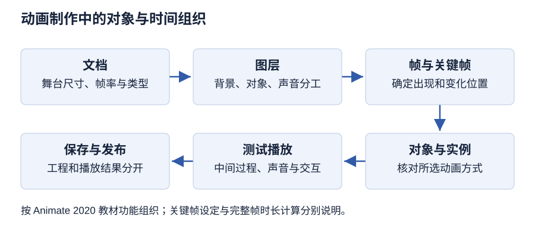

# 第 7 章 计算机动画制作技术

> 大纲定位：刘成明、石磊主编《多媒体技术及应用（第三版）》（清华大学出版社，2021 年），对应江苏省高等教育自学考试 13511《多媒体技术与应用》大纲（江南大学编，2024 年）。

## 学习导航

| 复习条目 | 层次 | 讲解 | 练习 |
| --- | --- | --- | --- |
| 动画原理、分类与文件格式 | 识记 | [第 1 节](#s1) | 1 |
| 动画原理的教材边界 | 领会 | [第 2 节](#s2) | 1 |
| Animate 工作界面与文档 | 领会、简单应用 | [第 3 节](#s3) | 2、7 |
| 绘图与文本操作 | 简单应用 | [第 4 节](#s4) | 2 |
| 时间轴、帧与帧率 | 识记、领会、简单应用 | [第 5 节](#s5) | 3、8 |
| 动作补间与形状补间 | 简单应用 | [第 6 节](#s6) | 4 |
| 遮罩、引导和骨骼动画 | 领会、简单应用 | [第 7 节](#s7) | 4 |
| Animate 声音、视频与交互 | 领会、简单应用 | [第 8 节](#s8) | 5 |
| Maya 三维动画流程 | 领会、综合应用 | [第 9 节](#s9) | 6 |
| 公式、条件与步骤 | 简单应用 | [第 10 节](#s10) | 3 |

## 应试导航 {#exam}

本章 10 个考纲条目：第 1 条识记分类与格式，第 2 条只要求领会教材对原理的说法，第 3、4、6、7、8 条落在简单应用上，第 5 条识记兼简单应用，第 9 条领会兼综合应用，第 10 条为简单应用。准备分三层：分类与格式名称背原文；三种帧、两类补间、遮罩与引导的判据背成对照；Maya 七步流程与帧数换时长按步骤和公式掌握。

### 考纲考点与卷面位置

| 考纲条目 | 层次 | 教材位置 | 常见出法 | 要背到哪一步 |
| --- | --- | --- | --- | --- |
| 1 动画原理、分类与文件格式（分类、GIF、SWF、Maya） | 识记 | 第 1 节 工作原理、计算机动画的分类、动画的文件格式 | 给出格式名判断压缩方式与能否存声音；给出分类维度让归位 | 五个分类维度逐条写全，四个格式各一句 |
| 2 动画原理的教材边界（视觉、教材说法） | 领会 | 第 1 节 计算机动画的工作原理 | 问动画为什么看起来连续，答案要落到教材说法 | 视觉暂留 1/24 秒一句，并说明这是教材的解释 |
| 3 Animate 工作界面与文档（舞台、时间轴、库、属性面板、FLA） | 领会、简单应用 | 第 2 节 Animate 2020 的工作界面、第 3 节 文档的基本操作 | 填空补界面组成部分；问保存后得到哪两种文件 | 五个界面组成部分各一句，FLA 与 SWF 的分工 |
| 4 绘图与文本操作（绘图、文本、路径、变换） | 简单应用 | 第 4 节 图形绘制基础、第 5 节 编辑文本 | 操作题按“选工具—绘制—检查”给分 | 简单与复杂图形各用哪些工具，三种文本的用途，分离两次各得到什么 |
| 5 时间轴、帧与帧率（普通帧、关键帧、空白关键帧、逐帧动画） | 识记、领会、简单应用 | 第 6 节 时间轴与帧的概念、第 7 节 逐帧动画效果 | 判断某帧类型的作用；问逐帧动画的代价 | 三种帧的定义与快捷键，逐帧动画的原理与代价 |
| 6 动作补间与形状补间（动作补间、形状补间、形状提示） | 简单应用 | 第 8 节 动作补间动画效果、第 9 节 形状补间动画效果 | 给出对象判断该用哪种补间；问形状提示的颜色与顺序 | 两类补间的对象条件、编辑参数、形状提示规则 |
| 7 遮罩、引导和骨骼动画（遮罩、引导层、骨骼） | 领会、简单应用 | 第 10 节 高级动画制作 | 问遮罩层能透过什么看到什么；问哪种对象不能作遮罩 | 遮罩四类实心对象、两类引导层、骨骼在两处出现的位置 |
| 8 Animate 声音、视频与交互（事件声音、音频流、ActionScript、热区） | 领会、简单应用 | 第 11 节 声音和视频、第 12 节 交互设计 | 比较两种声音的播放条件；问按钮四状态中哪个定热区 | 两种声音各一句，按钮四状态，ActionScript 可赋给谁 |
| 9 Maya 三维动画流程（建模、材质、骨骼、动画、灯光、渲染、后期） | 领会、综合应用 | 第 13 节 Maya 三维动画 | 综合题按七步给分并补前期流程 | 七步顺序不颠倒，每步产出物一句 |
| 10 公式、条件与步骤（帧数、帧率、完整帧时长） | 简单应用 | 第 6 节 认识帧、第 7 节 制作倒计时效果 | 给帧数与帧率求时长；问增加普通帧是否缩短时间轴 | 时长等于帧数除以帧率，并说明教材未列此式 |

### 常见出法（按大纲题型）

| 问法 | 出题依据 | 应对 |
| --- | --- | --- |
| 分类归位 | 第 1 条为识记层次，教材按五个维度分类 | 维度名与两项名称成组背，注意分类不是互斥的 |
| 格式判断 | 第 1 条要求识记文件格式，教材逐个小节给出压缩方式与用途 | GIF 无声、SWF 矢量、FLIC 无损、AVI 有损，四句不混 |
| 帧与补间判别 | 第 5、6 条为识记与简单应用层次 | 先判对象是元件实例还是形状，再判要变的是属性还是轮廓 |
| 参数与快捷键填空 | 识记层次含帧类型与操作，教材给出 F5、F6、F7 | 三个快捷键与三种帧一一对应 |
| 层次比较简答 | 领会层次要求理解原理与机制 | 逐帧与补间、遮罩与引导、事件声音与音频流各写两句区别 |
| 流程类综合 | 第 9 条含综合应用层次，教材第 13 节给出七步 | 按建模、材质、骨骼、动画、灯光、渲染、后期写，并补前期分镜 |

### 必背名词

| 术语 | 必背一句话 | 常考 |
| --- | --- | --- |
| 计算机动画 | 采用连续播放静止图像的方法产生景物运动效果，原理与传统动画相同，只是改由计算机处理画面 | 填空、简答 |
| 视觉暂留 | 人的眼睛看到一幅画或一个物体后，印象在 1/24 秒内不会消失，教材用它解释动画的运动观感 | 填空 |
| 全动画与半动画 | 按每秒播放幅数分类，全动画每秒 24 帧，半动画少于 24 帧 | 选择 |
| 实时动画 | 也称算法动画，用算法实现物体的运动 | 选择 |
| 逐帧动画 | 也称帧动画或关键帧动画，通过一帧一帧显示图像序列实现运动，帧序列内容不一样 | 选择、简答 |
| GIF | 点阵式图像文件格式，采用 LZW 压缩，支持 256 色、透明与动画，但无法存储声音 | 填空、选择 |
| FLIC | FLI 与 FLC 的通称，采用行程编码与 Delta 算法进行无损压缩 | 选择 |
| SWF | Animate 的矢量动画格式，用曲线方程描述内容，缩放不失真，可加 MP3，属准流式媒体 | 填空、选择 |
| FLA | Animate 的源文件，可再次编辑；发布得到的是 SWF | 填空 |
| 舞台 | Animate 中绘制和摆放对象的区域，尺寸、背景与帧率可在文档设置中修改 | 填空 |
| 时间轴 | 组织和控制动画内容在一定时间内播放的图层数与帧数，由图层、帧和播放头组成 | 填空 |
| 普通帧 | 连续普通帧内容相同，修改其中一帧其他帧同步更新，常放背景和静态文字 | 选择 |
| 关键帧 | 定义动画变化的帧，补间动画通过关键帧内插实现，过多会增大文件 | 选择、简单应用 |
| 空白关键帧 | 不继承左侧相邻帧内容的帧，每个新建文档都自带一个 | 选择 |
| 动作补间 | 又称动画补间，用于补间实例、组和文字的位置、大小、旋转、倾斜及颜色变化 | 简答、简单应用 |
| 形状补间 | 在两个不同形状的关键帧之间插入过渡帧，对象不能是元件实例 | 简答、简单应用 |
| 形状提示 | 用 a 到 z 共 26 个字母标识起始与结束形状中相对应的点，起始帧黄色、结束帧绿色 | 填空 |
| 遮罩层 | 特殊图层，透过遮罩层内的图形可以看到被遮罩层的内容，由普通层转换得到 | 简答 |
| 传统运动引导层 | 用于绘制对象运动路径的图层，其下图层成为被引导层，引导层中的对象发布时不显示 | 选择 |
| 事件声音 | 必须在动画全部下载完后才播放，没有停止命令就一直播放，只能插入一个帧中 | 简答、选择 |
| 音频流 | 前几帧下载足够数据后就开始播放，可与时间轴同步、边看边下载 | 简答 |
| 热区 | 按钮元件“点击”帧决定响应区域的大小，该帧无内容时响应区域与按钮相同 | 填空 |
| 骨骼动画 | 教材把骨骼反向动画与引导层、遮罩动画并列为高级动画；Maya 中骨骼用于模型装配 | 选择、综合 |

### 必背清单

**第 1 节**

1. 【考纲 1】按动作表现形式分：接近自然动作的完善动画（动画电视）与简化夸张的局限动画（幻灯片动画）。
2. 【考纲 1】按空间视觉效果分二维动画与三维动画；按播放效果分顺序动画（连续动作）与交互式动画（反复动作）。
3. 【考纲 1】按每秒播放幅数分全动画（每秒 24 帧）与半动画（少于 24 帧）。
4. 【考纲 1】按运动控制方式分实时动画（算法动画）与逐帧动画（帧动画或关键帧动画）；各维度描述同一批动画的不同侧面。
5. 【考纲 1】GIF 是点阵式图像文件格式，采用 LZW 压缩，支持 256 色、透明和动画，但不能存储声音，只能形成无声动画。
6. 【考纲 1】FLIC 是 FLI 与 FLC 的通称，采用行程编码与 Delta 算法无损压缩；FLI 最初基于 $320\times200$ 分辨率，FLC 不再局限于此。
7. 【考纲 1】SWF 是 Animate 的矢量动画格式，用曲线方程描述内容，缩放不失真，可添加 MP3 音乐，被称为准流式媒体文件。
8. 【考纲 1】AVI 是音频视频交错格式，把语音和影像同步组合，采用有损压缩，支持 256 色和 RLE 压缩。
9. 【考纲 1】二维软件有 Anime Studio Pro 与 Adobe Animate；三维软件有 Maya、3ds Max、SoftImage 3D、COOL 3D 和 Poser。

**第 2 节**

10. 【考纲 2】人眼看到一幅画或一个物体后，印象在 1/24 秒内不会消失；在一幅画消失前播放下一幅，就形成流畅的视觉变化。
11. 【考纲 2】计算机动画的原理与传统动画基本相同，只是把计算机技术用于动画的处理和应用；这是教材对原理的解释，实际帧率仍由作品与播放设备决定。

**第 3 节**

12. 【考纲 3】Animate 2020 界面由菜单栏、工具箱、时间轴面板、舞台和面板集构成；舞台是绘制与摆放对象的区域。
13. 【考纲 3】时间轴由图层、帧和播放头组成，播放动画时播放头沿时间轴向后滑动，图层和帧的内容随时间变化。
14. 【考纲 3】库集中保存元件与导入的资源；元件分图形、按钮和影片剪辑三种类型，从库拖到舞台即成为实例。
15. 【考纲 3】属性面板跟随当前选择，分别显示文档或所选对象的设置，改文档帧率要选中文档而不是对象。
16. 【考纲 3】保存后得到 FLA 源文件与 SWF 动画；只有 FLA 能再次编辑，文档也可另存为模板。
17. 【考纲 3】测试按 Ctrl+Enter，发布用“文件”菜单的“发布”命令；保存、测试、发布是三个不同环节。

**第 4 节**

18. 【考纲 4】简单图形用线条、矩形、椭圆、多角星形工具；复杂图形用钢笔、部分选取、铅笔和橡皮擦工具。
19. 【考纲 4】图形变形包括翻转、缩放、任意变形、扭曲和封套。
20. 【考纲 4】钢笔工具通过锚点绘制路径，拖动可改变曲率；部分选取工具用于编辑已有路径的形状。
21. 【考纲 4】文本分静态文本、动态文本和输入文本：静态文本用于固定内容，动态文本可由程序更新，输入文本供用户填写。
22. 【考纲 4】文本颜色只能用纯色，要用渐变须先分离成图形；分离一次成为单个字符，再分离成为填充图形，此后不再有文本属性。

**第 5 节**

23. 【考纲 5】普通帧延续同一内容，修改其中一帧其他帧同步更新，常用来放置背景和静态文字。
24. 【考纲 5】关键帧用来定义动画的变化，补间动画通过关键帧内插实现；关键帧不能太频繁，过多会增大文件。
25. 【考纲 5】插入关键帧后左侧相邻帧内容会自动复制过来，不想继承时用空白关键帧；每个新建文档都自带一个空白关键帧。
26. 【考纲 5】插入普通帧按 F5、插入关键帧按 F6、插入空白关键帧按 F7；帧还可以选择、删除、清除、复制、移动和翻转。
27. 【考纲 5】逐帧动画在连续关键帧中分解动作，每一帧都要创建内容；帧序列内容不一样使制作负担和文件量都大，但适合行走、头发飘动等细腻动作。

**第 6 节**

28. 【考纲 6】动作补间也称动画补间，可补间实例、组和文字的位置、大小、旋转、倾斜，以及颜色、渐变切换和淡入淡出；只改最后一个关键帧的对象，中间过程自动形成。
29. 【考纲 6】组或文字要改变颜色必须先转换为元件；要让文本块中每个字符分别运动，必须先分离为单个字符。
30. 【考纲 6】形状补间在某个关键帧画一个对象、在另一个关键帧修改或重画，由软件计算差别并插入过渡帧。
31. 【考纲 6】形状补间的对象不能是元件实例，图形元件和文字要先分离；完整形状补间至少要有一个起始帧和一个结束帧。
32. 【考纲 6】形状提示标识起始形状与结束形状中相对应的点，共 26 个字母 a 到 z，起始帧为黄色、结束帧为绿色，顺序必须一致。
33. 【考纲 6】混合方式有角形与分布式：角形让中间形状保留角和直线，分布式较平滑不规则；缓动参数控制速度变化，复杂补间宜先建中间形状。

**第 7 节**

34. 【考纲 7】遮罩层的作用是透过遮罩层内的图形看到被遮罩层的内容；与遮罩层没有关联的图层不会被看到。
35. 【考纲 7】遮罩层中的实心对象可以是填充形状、文字对象、图形元件实例或影片剪辑，线条不能充当遮罩。
36. 【考纲 7】遮罩层没有专门的创建按钮，都由普通层转换得到，紧贴其下的图层自动成为被遮罩层。
37. 【考纲 7】普通引导层主要用于辅助静态对象定位，可以不配被引导层单独使用；传统运动引导层用于绘制运动路径，其下图层成为被引导层。
38. 【考纲 7】引导层中的对象在最终发布时不会显示；右击选择“引导层”可把它转回普通图层。
39. 【考纲 7】教材把骨骼反向动画与引导层动画、遮罩层动画并列为高级动画类型；Maya 中骨骼用于装配角色模型，涉及 IK、FK、控制器与驱动关键帧。

**第 8 节**

40. 【考纲 8】事件声音必须在动画全部下载完后才播放，没有停止命令就一直播放，常用于按钮音效，且只能插入一个帧中。
41. 【考纲 8】音频流在前几帧下载足够数据后就开始播放，可与时间轴同步、边看边下载，多用于背景音乐。
42. 【考纲 8】Animate 可导入 WAV、MP3 等声音，不能直接导入 MIDI；导入的声音保存在库中，拖到舞台即加入文档，宜让每个声音独占一层。
43. 【考纲 8】交互效果主要靠 ActionScript 实现，动作可赋给帧、影片剪辑实例和按钮，编辑环境是“动作”面板，也可用“代码片断”面板。
44. 【考纲 8】按钮元件有弹起、指针、按下、点击四个状态：前三个决定按钮外观，“点击”决定响应区域的大小即热区。
45. 【考纲 8】该帧没有内容时响应区域与按钮相同；隐形按钮就是只在“点击”帧画热区，运行中看不到但可响应单击。
46. 【考纲 8】导入的视频会转换为 FLV 格式供 Animate 播放，可设为嵌入文件或链接文件。

**第 9 节**

47. 【考纲 9】三维部分的生产流程为建模、材质、骨骼、动画、灯光、渲染、后期七步；除后期合成要用视频编辑软件外，其余都在三维软件中完成。
48. 【考纲 9】前期流程与动画类型无关：先创建剧本，再制作文字分镜或画面分镜，以及角色设计、场景设计和道具设计。
49. 【考纲 9】完整流程还包括模型制作、设置（给模型绑定骨骼）、LAYOUT 三维故事板、动画制作、灯光材质与后期；渲染输出序列图，后期合成并添加特效输出。

**第 10 节**

50. 【考纲 10】动画播放长度以帧为单位而不是时间；帧率固定、每帧按完整帧时长计时长等于帧数除以帧率，例如 120 帧、24 fps 为 5 秒。
51. 【考纲 10】教材没有列出这条公式，它按帧率的定义推算；实际工程还要注意首末帧计数、时间线区间与导出设置。

### 必背数字与公式

| 项目 | 必背内容 |
| --- | --- |
| 视觉暂留 | 印象在 1/24 秒内不会消失 |
| 全动画与半动画 | 全动画每秒 24 帧；半动画少于 24 帧 |
| GIF | 支持 256 色，采用 LZW 压缩 |
| FLI 分辨率 | 最初基于 $320\times200$ |
| Animate 工作区 | 6 种界面布局 |
| 元件类型 | 图形、按钮、影片剪辑 3 种 |
| 按钮状态 | 弹起、指针、按下、点击 4 个 |
| 帧操作快捷键 | 普通帧 F5、关键帧 F6、空白关键帧 F7 |
| 倒计时实例 | 帧速率 10.00 fps，第 55 帧插入普通帧延长停留 |
| 形状提示 | a 到 z 共 26 个字母 |
| 形状补间最少帧数 | 起始帧与结束帧各一个，共 2 个关键帧 |
| 帧数与时长 | 时长 $=$ 帧数 $\div$ 帧率；120 帧、24 fps 为 5 秒 |
| Maya 时间单位 | 跳动小球实例把时间单位设为 Film（24 fps） |

### 易混对照

| 对照项 | 区别 | 判断依据 |
| --- | --- | --- |
| 逐帧动画与补间动画 | 逐帧动画每帧都建内容、帧序列各不相同；补间动画只给关键帧，中间由软件内插 | 中间帧是手工画的还是软件生成的 |
| 动作补间与形状补间 | 动作补间改变位置、大小、旋转、倾斜和颜色；形状补间改变对象轮廓本身 | 变的是属性还是形状 |
| 动作补间与形状补间的对象条件 | 动作补间对象可以是实例、组和文字；形状补间对象不能是元件实例，元件与文字要先分离 | 对象是不是元件实例 |
| 普通帧与关键帧 | 普通帧延续内容且改动会同步；关键帧定义变化，是补间的依据 | 该帧有没有黑色实心圆点 |
| 关键帧与空白关键帧 | 关键帧继承左侧内容后修改；空白关键帧不继承，画面为空 | 新帧里有没有沿用左侧内容 |
| 遮罩层与引导层 | 遮罩控制“看得到哪一部分”；引导层控制“沿哪条路径运动” | 解决的是可见范围还是运动路线 |
| 普通引导层与传统运动引导层 | 普通引导层辅助静态定位、可不配被引导层；传统运动引导层画路径并带被引导层 | 图层下面有没有被引导层 |
| 事件声音与音频流 | 事件声音要全部下载完才播、无停止命令就循环；音频流边下边播、与时间轴同步 | 播放是否要等下载完成 |
| 图形元件与元件实例 | 元件是库中可复用的对象，实例是拖到舞台上的那一份 | 改的是库中元件还是舞台上的实例 |
| FLA 与 SWF | FLA 是可再编辑的源文件，SWF 是发布出来的播放文件 | 还能不能继续编辑 |
| 保存、测试与发布 | 保存留下工程，测试在编辑环境中预览，发布生成交付文件 | 产出物是工程、预览还是可分发文件 |
| 按钮外观与热区 | 弹起、指针、按下决定外观，“点击”决定响应区域大小 | 鼠标在哪一区域里单击才会触发 |

### 简答答题模板

**计算机动画的分类**

按五个维度分条作答，每条给出两项名称：动作表现形式分完善动画与局限动画；空间视觉效果分二维与三维；播放效果分顺序动画与交互式动画；每秒播放幅数分全动画（24 帧）与半动画（少于 24 帧）；运动控制方式分实时动画（算法动画）与逐帧动画（帧动画或关键帧动画）。末句点明这些维度描述同一批动画的不同侧面。

**三种帧的区别**

普通帧：内容相同、改动同步，用来延续画面；关键帧：定义动画变化，是补间内插的依据，过多会增大文件；空白关键帧：不继承左侧内容、画面为空。再补三条快捷键 F5、F6、F7 与一句用途：静止背景用普通帧，动作变化用关键帧，需要重新起画面用空白关键帧。

**动作补间与形状补间的条件与区别**

动作补间补间实例、组和文字的位置、大小、旋转、倾斜与颜色变化，只需改最后一个关键帧的对象；组或文字要变色须先转元件，逐字运动须先分离。形状补间补间轮廓变化，对象不能是元件实例，图形元件与文字要先分离，且至少要有起始帧与结束帧各一个不同形状。判断时先看对象，再看要变的是属性还是形状。

**遮罩层与引导层的作用**

遮罩层：透过遮罩层内的图形显示被遮罩层内容，实心对象可以是填充形状、文字、图形元件实例或影片剪辑，线条不能作遮罩，遮罩层由普通层转换、下面一层自动成为被遮罩层。引导层：普通引导层辅助静态定位可不配被引导层，传统运动引导层画运动路径、其下图层成为被引导层，引导层中的对象发布时不显示。

**事件声音与音频流的区别**

事件声音：必须等动画全部下载完才播放，没有停止命令就一直播放，只能插入一个帧中，适合按钮音效；音频流：下载足够数据后即开始播放，可与时间轴同步、边看边下载，适合背景音乐。末句补一句实践做法：多数动画把两种声音结合使用。

**Maya 三维动画的制作流程**

先写前期：剧本、角色设计、文字分镜、画面分镜、模型制作、设置（绑定骨骼）、LAYOUT、动画制作、灯光材质、后期。再写三维七步：建模做形体，材质绘制贴图与质感，骨骼完成装配，动画调整骨骼按剧情活动，灯光布置光影，渲染输出序列图，后期合成并添加特效输出。

### 默写自测

先合上上面的内容写完，再展开对照。

1. 人眼看到一幅画后，印象在\_\_\_\_秒内不会消失，这一特性称为\_\_\_\_。
2. 按每秒播放幅数分类，全动画为每秒\_\_\_\_帧，半动画为\_\_\_\_。
3. 按运动控制方式分类，实时动画又称\_\_\_\_，逐帧动画又称\_\_\_\_或\_\_\_\_。
4. GIF 采用\_\_\_\_压缩，支持\_\_\_\_色，但不能存储\_\_\_\_。
5. SWF 是 Animate 的\_\_\_\_动画格式，用\_\_\_\_描述内容，缩放不失真。
6. FLIC 采用\_\_\_\_与\_\_\_\_算法进行无损压缩。
7. Animate 的元件分\_\_\_\_、\_\_\_\_、\_\_\_\_三种类型。
8. 保存 Animate 文档得到\_\_\_\_源文件和\_\_\_\_动画，只有前者能再次编辑。
9. 插入普通帧按\_\_\_\_，插入关键帧按\_\_\_\_，插入空白关键帧按\_\_\_\_。
10. 普通帧的内容\_\_\_\_，修改其中一帧其他帧\_\_\_\_。
11. \_\_\_\_关键帧不继承左侧相邻帧的内容，每个新建文档都自带一个。
12. 动作补间要改变组或文字的颜色，必须先把对象转换为\_\_\_\_。
13. 形状补间的对象不能是\_\_\_\_，图形元件与文字要先\_\_\_\_。
14. 形状提示共\_\_\_\_个字母，起始帧为\_\_\_\_色、结束帧为\_\_\_\_色。
15. 遮罩层中的实心对象可以是填充形状、文字对象、图形元件实例或影片剪辑，但\_\_\_\_不能充当遮罩。
16. 按钮元件的四个状态是\_\_\_\_、\_\_\_\_、\_\_\_\_、\_\_\_\_，其中\_\_\_\_决定热区大小。
17. 三维动画的生产流程为\_\_\_\_、\_\_\_\_、\_\_\_\_、\_\_\_\_、\_\_\_\_、\_\_\_\_、\_\_\_\_。
18. 帧率为 24 fps、共 120 帧时，播放时长为\_\_\_\_秒。

??? note "对照答案"
    1. 1/24；视觉暂留
    2. 24；少于 24 帧
    3. 算法动画；帧动画；关键帧动画
    4. LZW；256；声音
    5. 矢量；曲线方程
    6. 行程编码（RLE）；Delta
    7. 图形、按钮、影片剪辑
    8. FLA；SWF
    9. F5；F6；F7
    10. 相同；同步更新
    11. 空白
    12. 元件
    13. 元件实例；分离
    14. 26；黄；绿
    15. 线条
    16. 弹起、指针、按下、点击；点击
    17. 建模、材质、骨骼、动画、灯光、渲染、后期
    18. 5

## 1 动画原理、分类与文件格式 {#s1}

**必背：** 五个分类维度各含两项名称，全动画每秒 24 帧、半动画少于 24 帧；四个格式记住压缩方式与能否存声音，GIF 无声、SWF 为矢量、FLIC 无损、AVI 有损。

教材把计算机动画概括为：连续播放静止图像，产生景物运动效果；原理与传统动画相同，只是改由计算机处理画面。

教材按不同维度分类：动作表现形式分“完善动画”（动画电视）与“局限动画”（幻灯片动画）；空间视觉效果分二维动画与三维动画；播放效果分顺序动画（连续动作）与交互式动画（反复动作）；每秒播放幅数分全动画（每秒 24 帧）与半动画（少于 24 帧）；运动控制方式分实时动画（也称算法动画）与逐帧动画（也称帧动画或关键帧动画）。这些维度描述同一批动画的不同侧面，不是互斥的分类。

教材列出的常见格式有 4 种。GIF 是点阵格式，用 LZW 压缩，支持 256 色，可带透明和动画，但没有声音。FLIC 是 .fli 与 .flc 的通称，采用 RLE 和 Delta 无损压缩。SWF 是 Animate 的矢量动画格式，用曲线方程描述，缩放不失真。AVI 是音频视频交错格式（Audio Video Interleaved），有损压缩。

制作软件分二维与三维。二维软件有 Anime Studio Pro 和 Adobe Animate，Animate 做交互式矢量动画；三维软件有 Maya、3ds Max、SoftImage 3D、COOL 3D 和 Poser。软件、制作方法和输出格式是三件事：软件名不能直接说明作品用了逐帧还是补间，输出文件也不保证在任意终端播放。

## 2 动画原理的教材边界 {#s2}

**必背：** 视觉暂留是人的印象在 1/24 秒内不消失，教材用它解释动画为什么连续；这是教材说法，实际帧率仍由作品与设备决定。

教材用视觉暂留解释动画的运动观感：人眼看过一幅图或一件实物之后，印象在 1/24 秒内还不会消失。前一帧的印象尚未消退时接上后一帧，看起来就连贯起来了。这是教材说法，用来解释传统动画与计算机动画的共同原理；实际帧率仍由作品和播放设备决定。

## 3 Animate 工作界面与文档 {#s3}

**必背：** 界面五部分各自分工：舞台放对象、时间轴排帧、库存元件与资源、属性面板跟随选择；保存后得到 FLA 与 SWF，只有 FLA 能再编辑。

Animate 2020 的界面由舞台、时间轴、属性面板、库，以及菜单栏、工具箱和面板集构成。舞台是绘制和摆放对象的区域；时间轴按图层组织帧；属性面板跟随当前选择，显示文档或对象设置；库集中保存元件与导入的资源。“窗口”菜单可切换 6 种工作区；元件分图形、按钮和影片剪辑 3 种类型，从库里拖到舞台就是实例。

文档操作分新建、保存和打开三步。新建分空白文档与模板文档，舞台尺寸、背景和帧率可在“修改”|“文档”中修改。保存后得到 FLA 源文件和 SWF 动画格式，只有 FLA 能再次编辑，文档也可另存为模板。测试按 Ctrl+Enter，发布用“文件”|“发布”，保存、测试与发布是三个环节。

**文档任务。** 用 Animate（2020 版）制作“场馆开放提示”画面：新建文档并登记舞台尺寸、帧率，将背景、指示标记与标题分层，给图层命名。选中文档和选中标题各查看一次属性面板，说明设置对象的区别；保存 FLA，关闭后重开，检查图层、文字与资源。

## 4 绘图与文本操作 {#s4}

**必背：** 简单图形用线条、矩形、椭圆、多角星形，复杂图形用钢笔、铅笔、部分选取、橡皮擦；文本分静态、动态、输入三种，颜色只能用纯色，渐变要先分离。

教材绘图部分以线条、矩形、椭圆、多角星形工具画简单图形，以钢笔、铅笔、部分选取和橡皮擦工具画或改复杂图形；图形变形包括翻转、缩放、任意变形、扭曲和封套。文本部分讲静态文本、动态文本和输入文本，以及字符属性、段落属性和文本的分离与变形。

| 任务 | 一般步骤 | 操作后检查 |
| --- | --- | --- |
| 基本图形 | 选工具，设描边或填充，绘制 | 形状、大小、颜色及所在图层 |
| 路径与变换 | 选择对象，编辑路径或做变换 | 选区是否正确，形状是否符合目标 |
| 文字 | 选择文本类型，输入，设置属性 | 字体、字号、颜色、排列与文本框 |
| 文本变换 | 按示例分离或变换所选文字 | 是否仍需保留可编辑文字副本 |

三种文本按用途区分：静态文本用于固定内容，动态文本可由程序更新，输入文本供用户填写，常见于用户名、密码等场合。文本颜色只能用纯色，要用渐变须先分离成图形；分离一次成为单个字符，再分离一次成为填充图形，此后不再有文本属性，但可应用渐变或位图填充。绘图和文本是后续动画的素材；让内容随时间变化还要靠图层、关键帧与动画机制。

## 5 时间轴、帧与帧率 {#s5}

**必背：** 普通帧延续、关键帧定义变化、空白关键帧不继承，快捷键分别为 F5、F6、F7；逐帧动画每帧都建内容，细腻但制作负担与文件量都大。

时间轴管的是动画在时间上的排布：哪些图层、多少帧、在多长的时间段里播放，都由它组织。它的主要组件是图层、帧和播放头；动画长度以帧为单位，不以时间为单位。

普通帧延续同一内容，改其中一帧会同步更新，常放背景和静止文字；关键帧定义内容或变化，补间动画靠关键帧内插实现，关键帧过多会增大文件；空白关键帧不继承左侧内容，每个新建文档都自带一个。插入帧按 F5、插入关键帧按 F6、插入空白关键帧按 F7；帧还可以选择、删除、复制、移动和翻转。

逐帧动画又叫“帧帧动画”：它把一段动作拆进连续的多个关键帧，每一帧都单独建内容。这种画法与电影播放相近，适合行走、头发飘动这类细腻动作；代价是各帧画面都不一样，制作负担和文件量也都大。教材的倒计时实例在第 5、10、……、50 帧插入关键帧、第 55 帧插入普通帧，帧率设为 10.00 fps。

### 帧类型与逐帧任务

| 帧类型 | 内容作用 | 观察点 |
| --- | --- | --- |
| 普通帧 | 延续已有内容 | 画面持续但时间轴仍占帧 |
| 关键帧 | 定义内容或变化 | 修改此处所控制的内容 |
| 空白关键帧 | 不继承左侧内容 | 需要另行建立画面 |

**操作。** 为“闭馆提示”绘制三个依次出现的标记，在连续关键帧分别建立内容，再用普通帧延长最后一个标记的停留。插入空白关键帧前保存一个版本，对比插入前后的画面；同时记录帧数与帧率。逐帧动画的变化来自各关键帧内容，普通帧承担延续；画面看起来静止时，两者的区别仍在时间轴里。

## 6 动作补间与形状补间 {#s6}

**必背：** 动作补间改属性、对象可为实例组文字；形状补间改轮廓、对象不能是元件实例，图形与文字要先分离；形状提示 26 个字母、起始帧黄、结束帧绿。

动作补间（也叫动画补间）能改实例、组或文字的位置、大小、旋转和倾斜，也能做颜色、渐变颜色切换或淡入淡出：只改最后一个关键帧里的对象，中间过程由软件生成。组或文字要变色，得先转成元件；想让文本块里每个字各自运动，就得先分离成单个字符。教材示例“弹簧振子”把弹簧、滑块和底座做成图形元件，分层放到舞台，在不同帧设置位置和尺寸并创建传统补间。

形状补间表现对象形状的变化：在一个关键帧画出对象，在另一个关键帧修改或重画，由软件计算差别并插入过渡帧。形状补间的对象不能是元件实例，图形元件和文字要先分离成形状；完整形状补间至少要有一个起始帧和一个结束帧。教材用“几何切面”演示在关键帧中绘制不同形状再创建补间形状。复杂变化可加形状提示：形状提示用 a 到 z 共 26 个字母对应起始与结束形状，起始帧为黄色、结束帧为绿色，顺序必须一致；复杂补间宜先建中间形状。混合方式有“角形”和“分布式”，前者让中间形状保留棱角，后者较平滑、不规则，缓动参数控制速度变化。

同一个对象该用哪种补间，取决于要变的是属性还是形状：位置、大小、旋转、倾斜和颜色变化归动作补间，形状本身的变形归形状补间；元件实例不能用于形状补间，得先分离。

**对照任务。** 在独立图层上分别制作“指示标记横向移动”和“色块轮廓渐变”。前者先确认对象是元件实例或符合动作补间条件，再设首末状态；后者检查对象是否满足形状补间的条件并建立不同轮廓。预览时同时看端点和中间帧，记录出现跳变时的对象、关键帧及补间类型。

## 7 遮罩、引导和骨骼动画 {#s7}

**必背：** 遮罩层透过其中的图形看被遮罩层内容，线条不能作遮罩；普通引导层辅助定位、传统运动引导层画路径，引导层内容发布时不显示。

遮罩层是一种特殊图层：透过遮罩层里的图形，能看到下面被遮罩的内容。遮罩实心对象有四类：填充形状、文字对象、图形元件实例、影片剪辑；线条不能充当遮罩。遮罩层由普通图层转换得到（右击选“遮罩层”），紧贴其下的图层自动成为被遮罩层，也可把其他图层拖到其下或在“图层属性”中设“被遮罩”。教材的“地球自转”示例用圆形遮罩显露横向移动、首尾相接的地图。原书另有一处说法：凡未与某个遮罩层建立关联的图层，画面上就看不到。这句与常见软件行为不一致，按原意复述并标为原书疑点。

引导层分普通引导层和传统运动引导层两种。普通引导层主要辅助静态对象定位，可以不配被引导层单独使用；传统运动引导层用于绘制对象运动路径，与它链接的图层成为被引导层，其中的对象沿路径运动。引导层中的对象在最终发布时不会显示。教材“地球公转”实例把“地球 1”做成影片剪辑，添加传统运动引导层后画椭圆轨道、擦出豁口，再让第 1、100 帧的对象对齐豁口两端。

教材把骨骼反向动画与引导层、遮罩动画并列为高级动画的类型，但没有展开 Animate 骨骼工具的操作；Maya 部分把骨骼用于角色模型的装配，涉及 IK、FK、控制器和驱动关键帧。

**高级动画任务。** 用矩形窗口显示横向移动的彩条，分别保存遮罩形状、被遮罩图层和关联关系；再为另一标记建立弯曲引导路径，检查路径与动画所在帧区间及对象位置。预览和发布结果分别记录。原书关于未关联图层的疑点单独观察，不以预期代替软件结果。

## 8 Animate 声音、视频与交互 {#s8}

**必背：** 事件声音要全部下载完才播、无停止命令就循环；音频流边下边播、与时间轴同步；按钮四状态中“点击”定热区，动作可赋给帧、影片剪辑实例和按钮。

在 Animate 里，声音按播放方式分成两种：事件声音和音频流。事件声音须等动画全部下载完才能播放，没有停止命令就一直播放，常用于按钮音效；音频流在前几帧下载足够数据后就开始播放，能与时间轴同步、边看边下载，多用于背景音乐。Animate 2020 可以导入 WAV、MP3 等格式的声音，不能直接导入 MIDI；导入的声音保存在库中，拖到舞台即加入文档，宜让每个声音独占一层，播放时各层声音会混合。选中含声音波形的帧，在属性面板可设置效果和同步方式：同步方式有事件、数据流、开始、停止 4 种，另有重复与循环选项。

导入视频选择“文件”|“导入”|“导入视频”，按向导设定播放条外观并完成导入；视频会转换为 FLV 格式供 Animate 播放，可设为嵌入或链接。选中视频实例，可在属性面板设置实例名称、宽高与位置，在“组件参数”面板设置播放器参数。

Animate 的交互主要靠 ActionScript：动作可以赋给帧、影片剪辑实例和按钮。编辑环境是“窗口”|“动作”打开的“动作”面板，也可以在“代码片断”面板中选用现成片段。按钮元件的 4 个状态是弹起、指针、按下和点击：前三个决定按钮外观，“点击”决定响应区域的大小，也就是热区；该帧没有内容时响应区域与按钮相同，隐形按钮正是只在“点击”帧画了热区。教材的实例用 stop()、gotoAndStop() 等动作实现同一场景帧间和不同场景间的跳转。

**交互任务。** 为“开始说明”按钮制作可辨认的状态，登记可见图形与点击热区；导入自行录制的短旁白和视频，逐项测试单击、重复单击、播放结束及停止或跳转。记录声音的同步方式、视频实例及动作所在对象。保留工程、测试记录和发布结果，事件是否执行以实际预览为准。

## 9 Maya 三维动画流程 {#s9}

**必背：** 前期流程与动画类型无关（剧本、分镜、设计），三维七步是建模、材质、骨骼、动画、灯光、渲染、后期；除后期外都在三维软件中完成。

教材把流程分两层。前期与动画类型无关：先写剧本，再据剧本做文字分镜或画面分镜，以及角色、场景和道具设计。三维部分把生产拆成七步：建模、材质、骨骼、动画，再到灯光、渲染和后期；建模做出角色与场景，材质绘制贴图与质感，骨骼为角色装配骨骼系统（涉及 IK、FK 等），动画调整骨骼让角色按剧情活动，灯光布置光影，渲染输出序列图片，后期用合成软件合成为完整短片。教材实例是 Maya 2020 中的跳动小球：先把时间单位设为 Film(24fps)，再用自动关键帧与 S 键在第 1—70 帧逐点设置位置和旋转关键帧。

**三维任务。** 在 Maya 2020 中制作一块移动的方向指示牌：建立简单模型，设置材质和灯光，在不同时间点设置位移关键帧，预览运动，再渲染并整理后期输出。分别提交模型状态、关键帧位置、预览观察与输出检查记录。该场景只使用成书所述流程及关键帧操作，不复用教材跳动小球的场景或步骤数据。

## 10 公式、条件与步骤 {#s10}

**必背：** 动画长度以帧为单位，时长等于帧数除以帧率，120 帧、24 fps 为 5 秒；教材未列此式，按帧率定义推算，还要留意首末帧计数与导出设置。

在帧率恒定、每帧按完整帧时长计的模型里，播放时长（秒）=帧数÷帧率（帧/秒）。例如 120 帧、24 fps 对应 5 秒。成书没有列出这条公式，它是按帧率定义推出来的；实际工程还要留意首末帧计数、时间线区间和导出设置。

## 本章小结

- 动画按动作表现、空间、播放效果、每秒幅数和运动控制方式分类；视觉暂留是教材对运动观感的解释。
- 时间轴以帧组织内容：普通帧延续、关键帧定义变化、空白关键帧不继承；逐帧动画靠连续关键帧建立画面。
- 动作补间改变属性，形状补间改变轮廓；遮罩控制可见区域，引导层控制运动路径。保存、测试、发布是不同环节。

## 练习

**1. 展览同时使用实景录像和逐帧制作的示意动画。请分别记录制作方式、空间表现与输出格式，并解释为何不能只看播放文件扩展名就判断制作过程。**

考点：第 1、2 节；层次：识记、领会。

**答案：** 制作方式、二维或三维的空间表现以及输出格式属于不同观察维度。动画可以由连续画面表现变化，但播放文件不保存全部制作历史。要查项目、素材和制作流程；视觉暂留解释的是观看时的连贯感，与文件格式和制作方式无关。

**2. 同一段动画中的标题需要反复修改，而背景与角色应分别调整。为文档、图层、图形和文本安排组织方式；保存工作文档与发布动画各保留什么？**

考点：第 3、4 节；层次：简单应用。

**答案：** 先定义文档尺寸和制作要求，按内容职责分开组织背景、角色与标题；标题保留为便于编辑的文本对象，调整位置与格式时避免误改其他内容。保留可继续编辑的文档，同时另存面向播放的发布结果；二者不能互相替代。

**3. 一段时间轴从第1帧到第36帧，共36帧，按12帧/秒完整播放一次。求时长。若若干帧沿用同一画面，是否会因此减少时间轴长度？**

考点：第 5、10 节；层次：识记、简单应用。

**答案：** 在本题“共36帧”的计数约定下，时长为36÷12=3秒。相同画面可以在多个帧位置持续显示，它不自动删除时间轴上的帧；要缩短时长，需改变实际帧数或播放帧率，而不是仅观察画面是否变化。

**4. 一个对象沿曲线路径移动，另一个图形逐渐改变轮廓，还要让移动对象只在指定区域显露。分别确定需要解决的运动、形状和可见范围问题。**

考点：第 6、7 节；层次：领会、简单应用。

**答案：** 路径运动关注位置沿指定路线变化，可结合引导路径与适当补间；轮廓改变要按形状补间的对象条件设计；指定区域显露则涉及遮罩层与被遮罩内容。三个要求分属不同控制任务，不应以一个补间名称代替全部设计。

**5. 交互动画含开始按钮、旁白和视频片段。设计预览检查记录，说明哪些事件和时间关系必须验证，避免只检查画面第一帧。**

考点：第 8 节；层次：领会、简单应用。

**答案：** 应检查按钮触发后播放是否开始、重复触发的行为、旁白与画面的对应、视频片段的进入与结束，以及需要的停止或跳转。记录触发条件、预期动作与实际结果。声音、视频导入成功不表示交互逻辑与时间关系都正确，仍须实际预览。

**6. 三维动画已经建好模型，但最终画面仍缺少表面效果和可用镜头。将建模、材质、灯光、动画和渲染放入制作检查单，并说明一次渲染输出为何不等于整个三维项目都已验证。**

考点：第 9 节；层次：领会、综合应用。

**答案：** 建模解决形体，材质描述表面，灯光影响场景照明，动画组织随时间变化的动作，镜头决定观察方式，渲染形成输出画面。应分别检查静态外观和完整时间段，输出结果只是某些设置与时间点的结果；运动、镜头和连续播放都要另外检查。

**7. 制作者想改文档帧率，却一直选中舞台上的标题并修改文本属性。为什么属性面板中看到的设置没有达到目标？应先判断什么？**

考点：第 3 节；层次：领会。

**答案：** 属性面板随当前文档或所选对象显示相应设置。标题的字号、颜色等属于文本对象，文档帧率属于文档条件。应先辨明当前选择对象与要修改的层次，再进入相应文档设置；不能把面板名称相同理解为其中每项设置都作用于整个文档。

**8. 为提示灯逐次改变外观时，为什么要建立相应关键帧？如果只在末端增加普通帧，通常完成了什么任务？给出需要检查的时间轴内容。**

考点：第 5 节；层次：识记、领会、简单应用。

**答案：** 逐帧变化需要在相应关键帧中建立不同内容。普通帧用于延续已有内容，仅增加普通帧通常延长当前画面的持续时间，并未逐一建立新外观。应核查关键帧位置及内容、普通帧延续区间、空白关键帧是否造成空画面，并结合帧率预览整个时间段。
