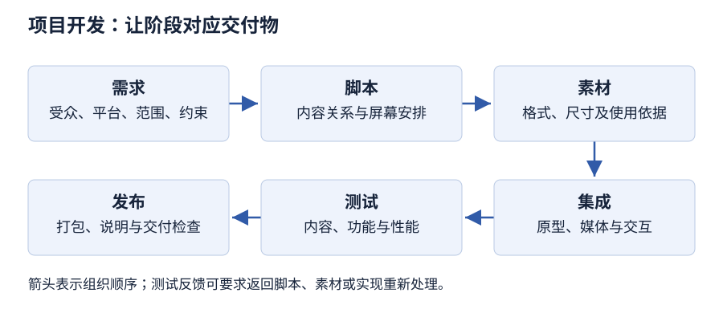

# 第 9 章 多媒体项目的开发过程

> 大纲定位：刘成明、石磊主编《多媒体技术及应用（第三版）》（清华大学出版社，2021 年），对应江苏省高等教育自学考试 13511《多媒体技术与应用》大纲（江南大学编，2024 年）。

## 学习导航

| 复习条目 | 层次 | 讲解 | 练习 |
| --- | --- | --- | --- |
| 规划与六阶段 | 识记 | [第 1 节](#s1) | 1、5 |
| 脚本、素材与集成 | 识记 | [第 2 节](#s2) | 1、2、5 |
| 测试与发布 | 识记 | [第 3 节](#s3) | 2、6 |
| 进度、估价与项目建议书 | 识记、领会 | [第 4 节](#s4) | 4、5 |
| 组织结构与用户界面 | 识记、领会 | [第 5 节](#s5) | 3 |
| 公式、条件与实施步骤 | 识记、领会 | [第 6 节](#s6) | 4、6 |

## 应试导航 {#exam}

本章 6 个考纲条目：前 3 条都是识记层次，第 4、5、6 条为识记兼领会。全章以“阶段—任务—交付物”为主干，客观题考名称与归属，简答与综合题考顺序与要点。准备时先按六阶段排好时间线，再把脚本两类、测试三方面、界面三原则、项目建议书七要点分别背成条目。

### 考纲考点与卷面位置

| 考纲条目 | 层次 | 教材位置 | 常见出法 | 要背到哪一步 |
| --- | --- | --- | --- | --- |
| 1 规划与六阶段（需求分析、脚本设计、素材准备、编码集成、测试运行、系统发布） | 识记 | 第 1 节 制作多媒体的过程 | 填空补阶段名或顺序；问某阶段的产物 | 六阶段按顺序默写，每阶段一句任务 |
| 2 脚本、素材与集成（概要设计、详细设计、规划任务、原型） | 识记 | 第 1 节 脚本设计、素材准备、编码集成 | 分辨文字脚本与制作脚本；问原型的作用 | 脚本三步骤，两类脚本各一句，集成两种方式 |
| 3 测试与发布（内容正确性、系统功能、系统性能、打包） | 识记 | 第 1 节 测试运行、系统发布 | 三项测试内容配对；问打包前先做什么 | 三方面测试各一句，打包定义与前置准备 |
| 4 进度、估价与项目建议书（进度、估价、项目建议书） | 识记、领会 | 第 1 节 进度安排、第 2 节 估价与项目建议书 | 问进度难排的原因；问项目建议书的要点 | 进度与估价各两条原因，建议书七要点 |
| 5 组织结构与用户界面（线性、层次、非线性、复合、导航图、用户界面） | 识记、领会 | 第 3 节 设计结构、设计用户界面 | 给场景判断结构类型；问三原则或布局色彩规则 | 四种结构的用户路径，三原则与布局、色彩、文字、音频要点 |
| 6 公式、条件与实施步骤（启动、客户合作、追踪、版权、风险） | 识记、领会 | 第 4 节 制作 | 问启动前检查哪些条件；问风险有哪些 | 启动检查项、确认与订单机制、命名与版本、版权处理、风险清单 |

### 常见出法（按大纲题型）

| 问法 | 出题依据 | 应对 |
| --- | --- | --- |
| 阶段顺序填空 | 第 1 条为识记层次，教材按六个阶段依次叙述 | 六阶段顺序不能颠倒：需求—脚本—素材—编码集成—测试—发布 |
| 名称配对 | 第 2、3 条为识记层次，教材成对给出概念 | 文字脚本对“主次轻重”，制作脚本对“表现形式与规范”；内容对“信息正确”，功能对“可用性”，性能对“可靠兼容效率” |
| 结构类型判断 | 第 5 条为识记兼领会，教材给出四种组织结构 | 先看用户能不能自由切换，再看有没有强制顺序 |
| 原则与要点列举 | 领会层次要求理解设计取舍 | 界面三原则、项目建议书七要点按条目背，不合并表述 |
| 实施与风险类简答 | 第 6 条含领会层次 | 按“启动前检查—客户确认—版本追踪—版权—风险”分条，每条一句 |

### 必背名词

| 术语 | 必背一句话 | 常考 |
| --- | --- | --- |
| 需求分析 | 六阶段的第一步，确定产品类型、内容和框架，再做用户分析、内容分析、资料收集和成本效益分析 | 填空、简答 |
| 脚本设计 | 为要制作的内容编写脚本，分概要设计、详细设计和规划任务三个步骤 | 填空 |
| 文字脚本 | 按目的、策略和重点把文本、图像、声音、动画材料分出主次轻重 | 选择、简答 |
| 制作脚本 | 在文字脚本基础上构思，规定表现形式、要实现的功能和制作规范 | 选择、简答 |
| 详细设计 | 为每个主题设计连续的屏幕，包括选择媒体、确定界面及风格、划分屏幕空间并定义热字热区 | 简答 |
| 规划任务 | 把设计落成具体工作，如确定创作平台、画导航图、成立工作组、创建原型等 | 选择 |
| 原型 | 概念验证或可行性研究，用来检测概念、建立接口模型、测试硬件平台 | 简答 |
| 编码集成 | 按脚本把已制成的素材连接成完整系统，分原型开发和 a 版本开发两步 | 填空 |
| β 版本阶段 | 测试运行阶段的别称，此时已投入时间、精力和金钱，只能向前推进 | 填空 |
| 打包 | 制作发行包，形成可以脱离具体制作环境、在操作系统下直接运行的应用系统 | 填空、简答 |
| 导航图 | 概括不同内容区域之间的关系或链接，提供内容列表和交互界面的逻辑流程图 | 选择、简答 |
| 情节串联图板 | 描述每个屏幕的图像、声音、导航选项的设计文档 | 选择 |
| 线性结构 | 用户按顺序一帧一帧地浏览信息 | 选择 |
| 层次结构 | 也称带有分支的线性结构，用户沿树状分支浏览，分支反映材料内容的自然逻辑关系 | 选择、简答 |
| 复合结构 | 用户可以自由浏览，但线性视频、关键信息或数据要按层次组织，浏览受其限制 | 选择 |
| 项目建议书 | 用于表达方案、明确工作范围与预算、平衡客户期望与可实施内容的文档 | 简答 |
| 估价 | 按任务及执行人员估算成本，把工具学习、会议与创作讨论时间计入预算 | 简答 |
| 三个可变元素 | 时间、资金、人，减少其中一项投入一般要增加另外两项 | 选择、简答 |

### 必背清单

**第 1 节**

1. 【考纲 1】多媒体产品开发当作软件工程问题处理：开工前必须有详细规划，确定项目范畴与内容，并在整个执行过程中以它为准。
2. 【考纲 1】六个阶段依次为需求分析、脚本设计、素材准备、编码集成、测试运行、系统发布。
3. 【考纲 1】需求分析先确定产品类型、内容和框架，再进行用户分析、内容分析、资料收集和成本效益分析。
4. 【考纲 1】需求分析要回答的问题：目标受众及其主题了解程度、回放平台与最低技术要求、客户及其需求、素材是否具备、是否需要交互、软硬件与存储是否够用、人员技术水平、时间与资金、发布方式与升级支持。
5. 【考纲 1】平衡目标与可行性有两种做法：先做一个功能最少的版本再逐步添加，或先列出全部功能再逐项删除不可行的部分。

**第 2 节**

6. 【考纲 2】脚本设计分概要设计、详细设计和规划任务三个步骤。
7. 【考纲 2】概要设计确定系统的总体结构，只搭粗略框架；脚本分文字脚本和制作脚本两类。
8. 【考纲 2】文字脚本按目的、策略和重点把文本、图像、声音、动画材料分出主次轻重；制作脚本在文字脚本基础上构思，规定表现形式、要实现的功能和制作规范。
9. 【考纲 2】详细设计为每个主题设计连续的屏幕：选择媒体、确定用户界面及其风格，借平面设计思想划分屏幕空间，定义热字热区并添加控制按钮，再用超链接完成屏幕间跳转。
10. 【考纲 2】规划任务把设计落成具体工作：确定创作平台、画导航图、创作情节串联图板、成立工作组、创建原型、测试功能、修正错误、创建黄金版本、准备打包和发布。
11. 【考纲 1】素材准备任务量最大，约占全部工作量的三分之二以上；五类素材为文字、音频、图形图像、动画、视频。
12. 【考纲 1】五类素材的获取方式：文字靠录入，音频靠软件创作或转换加工，图形图像靠扫描仪、数码相机或摄像机获取后加工，动画靠软件创作，视频靠摄像机或视频卡捕获后加工。
13. 【考纲 1】编码集成按脚本把已制成的素材连接成完整系统，分原型开发和 a 版本开发两步。
14. 【考纲 1】集成有两种方式：编程语言（Visual C++、Visual Basic 之类）能把脚本要求准确落地，但编码复杂、需专门程序员；平台软件（PowerPoint、Animate、Director 之类）上手容易，但能实现的功能相对少。
15. 【考纲 2】原型是概念验证或可行性研究，用来检测概念、建立接口模型、测试硬件平台，并从技术、成本、市场、内部使用和界面是否直观易用几方面检验。
16. 【考纲 2】并非每个原型都会发展为完整项目，有的在原型阶段就因实施困难、预算被削减或客户不接受而终止。

**第 3 节**

17. 【考纲 3】测试运行阶段也叫 β 版本阶段；测试首先关注内容正确性，即系统传递的信息是否正确。
18. 【考纲 3】系统功能主要指系统的可用性或用户满意度，落到两点：预计的功能是否都实现、人机界面是否友好。
19. 【考纲 3】系统性能包括系统可靠性、系统兼容性和系统效率。
20. 【考纲 1】集成方式不同测试节奏不同：用编程语言时边编码、边测试、边修改，每集成一个主题就重测一次；用平台软件时先建原型，再迭代推出新原型版本，逐版测试并回改设计与脚本。
21. 【考纲 1】测试之后要请用户试用、专家评估，收集意见并反复修改，必要时返回修改工作计划；试用过程要记录每个步骤和遇到的问题。
22. 【考纲 3】多媒体产品通过压缩或制成光盘发行，制作完成后必须打包；打包就是制作发行包，形成可以脱离制作环境、在操作系统下直接运行的应用系统。
23. 【考纲 3】打包前先优化硬盘上的文件组织结构并做好备份，再按发行介质选择打包发行方式；系统比较复杂时还要给出帮助信息和用户手册。

**第 4 节**

24. 【考纲 4】进度安排把阶段、任务、工作事项和可交付成果置于时间线上，估算各任务时间，再分配给异步工作的成员。
25. 【考纲 4】进度难排的原因在多媒体制作本身：美工的试验与调试耗时、录音要多次编辑、动画要反复运行调整、电影与屏幕活动同步要大量时间、软硬件升级要额外学习适应。
26. 【考纲 4】按任务及执行人员估计成本；第一次做同类任务要在学习工具上多花精力，第二次就省，第三次已算熟练。
27. 【考纲 4】美工、音乐人、教程设计者、写作人员参加项目会议和创作讨论的时间都要计入预算。
28. 【考纲 4】时间、资金、人是三个可变元素，减少其中一项投入一般要增加另外两项，例如工期紧就得多付加班与奖金并增加人手。
29. 【考纲 4】项目建议书用于表达方案、明确工作范围与预算、平衡客户期望和可实施内容；要点为封面和包装、目录、需求分析和描述、目标用户、创作策略、项目实施、预算。
30. 【考纲 4】目录部分可加入项目和预算总数的总述；实施部分写组织与进度方法、日程、预期日期、交付成果及任务，预算从这些任务提取；初次沟通信息不足时，不宜把初步判断写成精确报价。

**第 5 节**

31. 【考纲 5】线性结构用户按顺序一帧一帧地浏览信息；层次结构也称带有分支的线性结构，用户沿树状分支浏览，分支反映材料内容的自然逻辑关系。
32. 【考纲 5】非线性结构用户可以在内容之间自由切换，不受预定导航路线的限制；复合结构可自由浏览，但线性视频、关键信息或数据要按层次组织并限制浏览。
33. 【考纲 5】导航图概括不同内容区域之间的关系或链接，提供内容列表和交互界面的逻辑流程图；情节串联图板描述每个屏幕的图像、声音和导航选项。
34. 【考纲 5】项目结构图由情节串联图板和导航图组成；界面由图形元素和导航系统共同构成，四者分工不同，不能当作同义词。
35. 【考纲 5】界面三原则：以用户为中心，先做用户分析，照顾专家、初学者、门外汉及不同年龄层的特点；最佳媒体组合，看媒体是否恰当、是否相辅相成；尽量减少用户负担，布局控件菜单帮助提示一目了然并沿用熟悉平台的习惯与功能键。
36. 【考纲 5】布局要均衡、有序、经济、规范并突出主体：按从左到右、从上到下编排，主体放在页面中上方或左方，重点内容用闪烁动画或热键热区区分，按钮等次要内容放右下角。
37. 【考纲 5】色彩要有统一基调，按内容主次、风格及使用对象选择而不凭个人喜好；同屏颜色不宜过多，同一段文字一般同色；前景与活动对象鲜艳、背景与非活动对象暗淡；提示信息用习惯色，红色表示警告、绿色表示通行；尽量用绿蓝等健康色。
38. 【考纲 5】文字要简洁、多用短句，字体有层次、格式统一，字色与背景形成反差，关键词加亮或变色，较长文字分组分页避免滚动，英文标注宜用小写；音频要少用特殊音效，并一定提供关闭音效的开关。

**第 6 节**

39. 【考纲 6】启动前要检查软硬件兼容、存储空间、备份、时间统计与管理系统、命名约定、工具和专门技术、客户通信链路、行政财务条件和启动会议，单人项目同样检查。
40. 【考纲 6】与客户约定确认数量和周期，正式确认元素，对确认后的修改采用订单机制；事先协商数据存储介质与传输系统，使远程客户能检查项目。
41. 【考纲 6】追踪材料接收，按结构制定命名和目录规则；多人处理时确认最新版及持有人，必要时归档旧版本；命名不等于版本控制。
42. 【考纲 6】版权处理讨论代码要不要给别人看、写得是否简洁、有没有加注释；项目里可以加一段版权声明；代码本身、窍门和手法则留给别人研究、学习和改动。
43. 【考纲 6】风险要预先考虑测试、客户确认、付款和不可控因素；常见困扰包括合作者不愿接受或给出批评、客户无权决策、连续两天以上通宵、过多自定义代码规范、过多或工作外的会议、超过最后期限。

### 必背数字与公式

| 项目 | 必背内容 |
| --- | --- |
| 开发阶段数 | 六个：需求分析、脚本设计、素材准备、编码集成、测试运行、系统发布 |
| 脚本设计步骤 | 三步：概要设计、详细设计、规划任务 |
| 脚本类型 | 两类：文字脚本、制作脚本 |
| 素材工作量占比 | 约占全部工作量的三分之二以上 |
| 素材类别 | 五类：文字、音频、图形图像、动画、视频 |
| 编码集成步骤 | 两步：原型开发、a 版本开发 |
| 集成方式 | 两种：编程语言、平台软件 |
| 测试内容 | 三项：内容正确性、系统功能、系统性能 |
| 组织结构 | 四种：线性、层次、非线性、复合 |
| 界面设计原则 | 三条：以用户为中心、最佳媒体组合、尽量减少用户负担 |
| 项目建议书要点 | 七项：封面和包装、目录、需求分析和描述、目标用户、创作策略、项目实施、预算 |
| 可变元素 | 三个：时间、资金、人 |

### 易混对照

| 对照项 | 区别 | 判断依据 |
| --- | --- | --- |
| 文字脚本与制作脚本 | 文字脚本安排材料的主次轻重；制作脚本规定表现形式、功能与制作规范 | 说的是内容轻重还是呈现规范 |
| 概要设计与详细设计 | 概要设计定总体结构、只搭框架；详细设计逐屏幕安排媒体、界面与交互 | 产出是框架还是逐屏方案 |
| 原型与 a 版本 | 原型是概念验证与可行性研究，可能终止；a 版本是接着做下去的完整开发版本 | 目的是验证还是生产 |
| 内容正确性与系统功能 | 内容正确性看信息是否正确；系统功能看功能是否实现、界面是否友好 | 错在信息本身还是使用体验 |
| 系统功能与系统性能 | 功能看可用性与满意度；性能看可靠性、兼容性与效率 | 好不好用还是稳不稳、快不快 |
| 导航图与情节串联图板 | 导航图表达内容区域之间的关系与逻辑流程；情节串联图板描述每个屏幕的图像、声音与导航选项 | 描述关系还是描述单屏 |
| 线性结构与层次结构 | 线性按顺序逐帧浏览；层次沿树状分支浏览 | 有没有分支选择 |
| 层次结构与非线性结构 | 层次仍有树状路线；非线性不受预定导航路线限制 | 浏览路线是否被规定 |
| 打包与发布 | 打包是制作可脱离制作环境的发行包；发布还包括按介质选择方式、帮助与手册 | 产物是包还是完整发行 |
| 命名与版本控制 | 命名只是给文件起可识别的名字；版本控制还要确认最新版及持有人、归档旧版本 | 有没有记录“哪一版是最新可交付” |
| 估价与项目建议书 | 估价算的是时间、资金与人力成本；建议书是表达方案、范围与预算的文档 | 算成本还是对外表达方案 |

### 简答答题模板

**多媒体产品开发的六个阶段**

按顺序写并各补一句：需求分析确定类型、内容与框架并做用户、内容、资料与成本效益分析；脚本设计分概要与详细并规划任务；素材准备按格式与尺寸要求准备五类素材；编码集成按脚本集成并先验证原型；测试运行检查内容、功能与性能并记录反馈；系统发布备份、打包、给说明并安排后续支持。末句点明六阶段是先后关系而非并列。

**脚本设计的三个步骤**

第一步概要设计：确定总体结构，只搭粗略框架，脚本分文字脚本与制作脚本，前者分主次轻重，后者定表现形式、功能与规范。第二步详细设计：为每个主题设计连续屏幕，选媒体、定界面风格、划分屏幕空间、定义热字热区与控制按钮，用超链接完成跳转。第三步规划任务：确定创作平台、画导航图、创作情节串联图板、成立工作组、创建原型、测试与修正、创建黄金版本、准备打包发布。

**测试运行的三个方面**

内容正确性：检查系统传递的信息是否正确。系统功能：看可用性与用户满意度，即预计功能是否都实现、人机界面是否友好。系统性能：包括可靠性、兼容性和效率。再补测试节奏：用编程语言边编码边测试边修改，每集成一个主题重测一次；用平台软件先建原型再逐版迭代测试，测试后请用户试用与专家评估并记录问题。

**人机界面设计的三条原则与布局要点**

三原则：以用户为中心，先做用户分析并照顾不同熟练程度与年龄层的思维、生理、技能特点；最佳媒体组合，界面好坏不看媒体种类多少，而看所选媒体是否恰当、是否相辅相成；尽量减少用户负担，布局、控件、菜单、帮助提示一目了然并沿用熟悉的平台习惯与功能键。布局要点：均衡有序经济规范、突出主体，按从左到右从上到下编排，主体居中上或左方，次要内容放右下角。

**系统发布与打包**

先写定义：打包就是制作发行包，形成可脱离制作环境、在操作系统下直接运行的应用系统。再写前置：打包前优化硬盘上的文件组织结构并做好备份，按发行介质选择打包发行方式；系统复杂时给出帮助信息和用户手册。末句补检查：打包后要脱离制作目录重新检查入口、资源与播放，并与客户确认版本。

**项目的估价与三个可变元素**

估价按任务及执行人员估算，把工具学习成本与会议、创作讨论时间计入；第一次做同类任务要在学习工具上多花精力，第二次就省，第三次已熟练。时间、资金、人是三个可变元素，减少其中一项投入一般要增加另外两项，例如工期紧就要多付加班与奖金并增加人手。末句提醒：不能直接把人数翻倍写成工期减半。

### 默写自测

先合上上面的内容写完，再展开对照。

1. 多媒体产品开发的六个阶段依次为\_\_\_\_、\_\_\_\_、\_\_\_\_、\_\_\_\_、\_\_\_\_、\_\_\_\_。
2. 需求分析要确定产品的类型、内容和\_\_\_\_，再做用户分析、内容分析、资料收集和\_\_\_\_分析。
3. 脚本设计分\_\_\_\_、\_\_\_\_和\_\_\_\_三个步骤。
4. 脚本分\_\_\_\_脚本和\_\_\_\_脚本两类。
5. 素材准备约占全部工作量的\_\_\_\_以上。
6. 五类素材是\_\_\_\_、\_\_\_\_、\_\_\_\_、\_\_\_\_、\_\_\_\_。
7. 编码集成分\_\_\_\_开发和\_\_\_\_版本开发两步。
8. 集成方式有两种：\_\_\_\_和\_\_\_\_。
9. 测试运行阶段又称\_\_\_\_阶段。
10. 测试关注三个方面：\_\_\_\_、\_\_\_\_、\_\_\_\_。
11. 系统性能包括\_\_\_\_、\_\_\_\_和\_\_\_\_。
12. 打包就是制作\_\_\_\_，形成可脱离制作环境直接运行的应用系统。
13. 四种组织结构是\_\_\_\_、\_\_\_\_、\_\_\_\_、\_\_\_\_。
14. 人机界面设计的三条原则是\_\_\_\_、\_\_\_\_、\_\_\_\_。
15. 项目建议书的要点包括封面和包装、目录、需求分析和描述、目标用户、\_\_\_\_、项目实施和\_\_\_\_。
16. 时间、资金、人是三个\_\_\_\_元素，减少其中一项一般要增加另外两项。

??? note "对照答案"
    1. 需求分析、脚本设计、素材准备、编码集成、测试运行、系统发布
    2. 框架；成本效益
    3. 概要设计、详细设计、规划任务
    4. 文字；制作
    5. 三分之二
    6. 文字、音频、图形图像、动画、视频
    7. 原型；a
    8. 编程语言；平台软件
    9. β 版本
    10. 内容正确性、系统功能、系统性能
    11. 可靠性、兼容性、效率
    12. 发行包
    13. 线性、层次、非线性、复合
    14. 以用户为中心、最佳媒体组合、尽量减少用户负担
    15. 创作策略；预算
    16. 可变

## 1 规划与六阶段 {#s1}

**必背：** 六阶段按需求分析、脚本设计、素材准备、编码集成、测试运行、系统发布排列，每阶段都有可交付成果；规划确定范畴与内容并贯穿全程。

教材开篇就把多媒体产品开发当作软件工程问题：开工前必须有详细规划，确定项目范畴与内容，并在整个执行过程中以它为准。规划结合技术、时间、预算、工具与资源，贯穿项目始终。六个阶段依次为需求分析、脚本设计、素材准备、编码集成、测试运行、系统发布，图 9-1 给出这个顺序。

| 阶段 | 主要任务 |
| --- | --- |
| 需求分析 | 明确用户、内容和约束，判断可行性 |
| 脚本设计 | 安排媒体、结构与系统脚本 |
| 素材准备 | 准备符合格式与尺寸要求的媒体 |
| 编码集成 | 按脚本集成，先验证原型 |
| 测试运行 | 检查内容、功能与性能，记录反馈 |
| 系统发布 | 备份、打包、说明和后续支持 |

需求分析要回答的问题，教材列得很细：项目的本质、目标和信息是什么；目标受众是谁、他们对主题了解多少、回放平台及最低技术要求；是否有客户及其需求；怎样组织项目；哪些媒体适合传递信息；手头已有录像带、音乐、文档、照片等素材吗；是否需要交互；可用软硬件与存储空间够不够；人员技术水平如何；需要多少时间和资金；怎样发布、是否要提供升级与支持。教材提出两种平衡目标与可行性的做法：先做一个功能最少的版本再逐步添加，或先列出全部功能再逐项删除不可行的部分（同页）。



## 2 脚本、素材与集成 {#s2}

**必背：** 脚本三步骤是概要设计、详细设计、规划任务，两类脚本分工要分清；素材占工作量三分之二以上；集成分原型与 a 版本两步，编程语言与平台软件各有代价。

脚本设计为要制作的内容编写脚本，分概要设计、详细设计和规划任务三个步骤。概要设计确定系统的总体结构，只搭粗略框架，脚本分文字脚本和制作脚本：文字脚本按目的、策略和重点把文本、图像、声音、动画材料分出主次轻重；制作脚本在文字脚本基础上构思，规定表现形式、要实现的功能和制作规范。详细设计为每个主题设计连续的屏幕，包括选择媒体、确定用户界面及其风格，屏幕设计借平面设计思想划分屏幕空间，交互设计在屏幕上定义热字、热区并添加控制按钮，再用超链接完成屏幕间跳转。规划任务把设计落成具体工作，如确定创作平台、画导航图、创作情节串联图板、成立工作组、创建原型、测试功能、修正错误、创建黄金版本、准备打包和发布等。

素材准备收集并处理脚本所需的各类媒体，教材说这一阶段任务量最大，约占全部工作量的三分之二以上。五类素材为文字、音频、图形图像、动画、视频：文字靠录入，音频靠软件创作或转换加工，图形图像靠扫描仪、数码相机或数码摄像机获取后加工，动画靠软件创作，视频靠摄像机或视频卡捕获后加工。无论是录入、获取还是采集，都要按标准经多道工序，达到要求的格式和尺寸，素材收集才算完成。

编码集成按脚本把已制成的素材连接成完整系统，分原型开发和 a 版本开发两步。集成方式有二。其一是编程语言（Visual C++、Visual Basic 之类）：脚本要求能准确落地，代价是编码复杂，得由专门程序员来写。另一条是选平台软件（PowerPoint、Animate、Director 之类）：上手容易，一般开发人员就能做，能实现的功能相对少。原型是概念验证或可行性研究，用来检测概念、建立接口模型、测试硬件平台，并从技术、成本、市场、内部使用和界面是否直观易用几个方面检验。并非每个原型都会发展为完整项目，有的在原型阶段就因实施困难、预算被削减或客户不接受而终止。

## 3 测试与发布 {#s3}

**必背：** 测试运行即 β 版本阶段，看内容正确性、系统功能、系统性能三方面；打包是制作发行包，打包前先优化文件组织并备份。

测试运行阶段也叫 β 版本阶段，测试仍要关注三个方面：内容正确性，即系统传递的信息是否正确；系统功能看的是好不好用、用户满不满意，落到两点：预计的功能是否都实现、界面是否友好；系统性能，包括可靠性、兼容性和效率。集成方式不同，测试节奏也不同：用编程语言时边编码、边测试、边修改，每集成一个主题就重测一次；用平台软件时先建原型，再迭代推出新原型版本，逐版测试并回改设计与脚本。测试之后要请用户试用、专家评估，收集意见反复修改，必要时返回工作计划重新安排，试用过程要记录每个步骤和遇到的问题。

打包就是做出一个发行包，让作品离开制作环境后仍能在操作系统里直接运行。打包前先优化硬盘上的文件组织结构并做好备份，再按发行介质选择打包发行方式；系统比较复杂时还要给出帮助信息和用户手册。教材的发行语境是压缩或制成光盘，介质变了，打包与交付检查这两步仍要做。

## 4 进度、估价与项目建议书 {#s4}

**必背：** 进度把阶段与可交付成果放到时间线上；估价按任务与人员算，时间、资金、人是三个可变元素；项目建议书七要点里实施与预算相互对应。

将阶段、任务、工作事项和可交付成果置于时间线上，估算各任务时间，再分配给异步工作的成员。进度难排，原因在多媒体制作本身：美工的试验与调试耗时，录音要多次编辑修改，动画要反复运行调整，QuickTime 或 MPEG 电影与屏幕活动同步也要大量时间，软硬件升级还要额外学习和适应。

按任务及执行人员估计成本。第一次做同类任务要在学习工具上多花精力，第二次就省，第三次已算熟练；美工、音乐人、教程设计者、写作人员参加项目会议和创作讨论的时间都要计入预算。时间、资金、人是三个可变元素：减少其中一项的投入，一般要增加另一两项，例如工期紧就得多付加班与奖金并增加人手。

用于表达方案、明确工作范围与预算，平衡客户期望和可实施内容。要点为封面和包装、目录、需求分析和描述、目标用户、创作策略、项目实施、预算。目录部分可加入项目和预算总数的总述；实施部分写组织和进度方法、日程、预期日期、交付成果及任务，预算从这些任务提取。初次沟通信息不足时，不宜把初步判断写成精确报价。

## 5 组织结构与用户界面 {#s5}

**必背：** 四种结构按“能否自由切换、有没有分支”判；界面三原则是以用户为中心、最佳媒体组合、尽量减少用户负担；布局、色彩、文字、音频各有成文规则。

| 结构 | 用户路径 | 判据 |
| --- | --- | --- |
| 线性 | 顺序逐帧浏览 | 固定顺序，一帧接一帧 |
| 层次 | 沿树状分支浏览 | 分支依材料逻辑 |
| 非线性 | 在内容间自由切换 | 不受预定导航路线限制 |
| 复合 | 自由浏览与线性片段、层次组织结合 | 自由浏览加局部线性 |

层次结构又称带有分支的线性结构，分支反映材料的自然逻辑。复合结构里，用户可以自由浏览，但线性视频、关键信息或数据要按层次组织，浏览会受这些内容限制。

导航图把各内容区域之间的关系和链接画出来，给出内容清单和交互界面的逻辑流程；情节串联图板描述每个屏幕的图像、声音、导航选项，可细到颜色、字体、按钮形状与响应；项目结构图由情节串联图板和导航图组成；界面由图形元素和导航系统共同构成。四者分工不同，不能当作同义词。

人机界面设计有三条基本原则：以用户为中心，先做用户分析，照顾专家、初学者、门外汉以及不同年龄层的思维、生理和技能特点；最佳媒体组合，界面好坏不看媒体种类多少，而看所选媒体是否恰当、是否相辅相成；尽量减少用户负担，窗口布局、控件、菜单、帮助提示要一目了然，并沿用用户熟悉的平台习惯与功能键。

设计界面时，布局要均衡、有序、经济、规范，突出主体；按视觉习惯从左到右、从上到下编排，主体放在页面的中上方或左方，重点内容用闪烁、动画或热键热区区分开，按钮等次要内容放在右下角，窗口、菜单、按钮的格式与操作方法尽量标准化。色彩上，整部产品要有统一基调，按内容主次、风格及使用对象选择，不凭个人喜好；同屏颜色不宜过多，同一段文字一般同色；前景与活动对象颜色鲜艳，背景与非活动对象暗淡，提示信息用习惯色，如红色表示警告、绿色表示通行；尽量用绿、蓝等健康色，让画面温馨柔和、不刺眼。文字上，句子要短、说清楚就行；字体分出层次、格式统一；字色与背景拉开反差，关键词加亮或换色；长文拆成几组几页，别让用户滚动；英文标注用小写字母。音频要选合内容与氛围的音乐与音效，尽量少用特殊音效，并一定给用户一个关闭音效的开关。

## 6 公式、条件与实施步骤 {#s6}

**必背：** 启动前先排除隐患（软硬件、存储、备份、命名与启动会议），客户确认与修改走订单机制，命名不等于版本控制，风险要在变严重之前处理。

本章没有通用成本计算式或可直接套用的固定工期，可按教材组织以下工作清单。

1. **启动前。** 检查软硬件兼容、存储、备份、时间统计与管理系统、命名约定、工具和专门技术、客户通信链路、行政财务条件和启动会议；单人项目同样检查。
2. **客户合作。** 约定确认数量和周期，正式确认元素，对确认后的修改采用订单机制；事先协商数据介质与传输系统，使远程客户能检查项目。
3. **追踪和版本。** 追踪材料接收，按结构制定命名和目录规则；多人处理时确认最新版及持有人，必要时归档旧版本。命名不等于版本控制。
4. **版权。** 教材讲的是开放代码下注释与版权声明怎么处理：代码要不要给别人看，写得是否简洁、有没有加注释；项目里可以加一段版权声明；代码本身、窍门和手法，则留给别人研究、学习和改动。素材与代码的授权另按来源处理。
5. **风险。** 预先考虑测试、客户确认、付款和不可控因素；教材列的常见困扰包括合作者不愿接受或给出批评、客户无权决策、连续两天以上通宵、过多的自定义代码规范、过多或工作外的会议、超过最后期限，这些问题要在变严重之前处理。

### 跨章学习扩展：社区场馆参观指南

这是把前面几章串起来的练习：用第 3 至 8 章的素材处理与集成能力，做一个场馆参观指南。需求暂定为访客选择场馆区域，阅读说明、查看指示图并播放操作演示；每段操作演示内部保持固定顺序。目标终端、交付方式、预算与期限由实际项目填写。

#### 需求与素材记录

| 记录 | 本例的起点 | 开始前待填写 |
| --- | --- | --- |
| 受众与任务 | 首次到访者；选择参观区域 | 知识背景、使用环境 |
| 范围 | 首页、区域说明、演示入口 | 内容数量、确认责任人 |
| 交互 | 选择区域、返回、播放控制 | 操作预期与终止条件 |
| 资源 | 自写文字、自绘指示图、自录旁白 | 素材位置、来源及使用依据 |
| 交付 | 工程、关联素材、播放或站点文件 | 平台、介质、日期与支持 |

素材表另设“编号、用途、版本、格式、尺寸或时长、处理任务、确认状态、存放位置”字段。第 3 章处理说明文字，第 4 章处理图片，第 5 章处理旁白，第 6 章处理演示，第 7 章处理提示动画，第 8 章负责集成与访问；只引用已完成并检查的成果，尚未实测的任务保留状态。

#### 导航与屏幕脚本

```text
首页 → 区域选择 → 区域说明 → 操作演示
  ↑       ↑           │          │
  └───────┴───────────┴──────────┘ 返回入口
```

该关系图是本例的导航草图：区域之间可以自由选择，演示片段内部顺序固定，整体按复合结构组织，连线仍要在实际页面里逐条核对。

| 屏幕 | 内容与媒体 | 用户动作 | 预期结果 |
| --- | --- | --- | --- |
| 首页 | 标题、参观范围、入口 | 选择进入 | 到达区域选择 |
| 区域说明 | 文字、指示图、旁白 | 返回或播放演示 | 回到选择或进入演示 |
| 操作演示 | 视频、字幕、播放控制 | 播放、停止、返回 | 完成对应动作 |

屏幕脚本还要登记媒体编号、按钮或热区、跳转目标和需要确认的内容。脚本确认后再集成；若客户增加一个区域，应同时回查素材、导航、屏幕、任务、测试与交付范围。

#### 任务、估价与验收记录

| 任务 | 前置成果 | 交付物 | 待估字段 |
| --- | --- | --- | --- |
| 确认内容 | 受众与范围 | 需求和脚本 | 负责人、确认周期 |
| 制作素材 | 已确认脚本 | 文字、图像、音视频 | 人员工时、工具学习 |
| 集成原型 | 可用素材与导航 | 可测试版本 | 实施工时、依赖任务 |
| 测试修订 | 原型与检查项 | 问题及复查记录 | 测试、修订与沟通时间 |
| 打包交付 | 复查通过的版本 | 发行包与说明 | 介质、发布及支持费用 |

估价从实际任务和人员提取，另计工具、会议及反复调整；没有实际测算时不填精确价格。下面这套记录格式参照教材第 9.2、9.3 节组织。

测试记录使用“版本、环境、检查对象、输入或操作、预期、实际、问题、复查日期”字段。例如区域图文是否正确属于内容检查；返回入口是否到达指定页面属于功能检查；目标终端能否完整播放属于兼容性检查。实际结果由测试者填写，不能预先写成通过。

交付清单包括确认过的需求与脚本、素材及来源记录、可编辑工程与关联文件、发行包、操作说明、测试与复查记录、未决问题和后续联系人。打包后脱离制作目录重新检查入口、资源与播放，再按客户约定确认版本；素材与代码的授权另按来源处理。

## 本章小结

- 把需求、脚本、素材、集成、测试和发布落实到可交付成果；前期说明还要覆盖受众、平台、范围、资源及时间约束。
- 内容正确性、功能可用性与运行兼容性分别记录；导航图描述关系，屏幕设计安排呈现，两者共同降低用户负担。
- 范围变更要重新核对依赖任务、估价、确认与版本。人数和工期不保证线性互换，文件已生成也不等于已完成目标环境验收。

## 练习

**1. 客户要求一个可交互展览样机，却只给出“尽快完成”的期限。把需求分析、脚本、素材、集成、测试和发布转成可交付成果，并指出首先要补齐哪些约束。**

考点：第 1、2 节；层次：识记。

**答案：** 先确认目标用户、使用平台、交互范围、可用素材与交付条件，再把需求形成说明、把脚本形成内容与导航设计、把素材形成可用资源集，随后集成原型、记录测试并形成发行包。缺少范围、时间和资源约束时，不能把模糊愿望直接写成确定承诺。

**2. 内部原型能运行，客户却指出内容错误、按钮难找，换一台机器还无法播放。将问题分别纳入测试记录，并说明为什么“能运行”不足以关闭全部问题。**

考点：第 2、3 节；层次：识记。

**答案：** 内容错误属于内容核查，按钮难找涉及功能可用性与用户体验，另一设备无法播放需要检查兼容性及运行条件。原型用于发现设计和实现问题，单一环境能运行并不能覆盖这些维度。记录问题、调整脚本或实现后，应按原测试条件复查。

**3. 方案允许自由浏览展品，但每段安全演示必须按固定顺序播放。选择适合的组织结构，说明导航图与屏幕设计各解决什么，并给出降低用户操作负担的做法。**

考点：第 5 节；层次：识记、领会。

**答案：** 自由选择展品与片段内部固定顺序可以组合成复合结构。导航图表达内容之间的关系与跳转；屏幕设计安排文字、媒体和控件。保持返回入口及按钮含义一致，突出当前任务，给声音控制等明确选择，避免要求用户记住上一屏才能继续。

**4. 客户在确认后增加新片段，且团队发现一份素材来源不清。为进度、估价、客户确认、版本追踪和发布安排处理记录，能否直接把人数翻倍写成工期减半？**

考点：第 4、6 节；层次：识记、领会。

**答案：** 先登记范围变更与确认责任，重新核对受影响的任务、素材、成本和交付日期；来源不清的素材在取得可用依据或替代前不应作为可发布成果。保存确认记录与版本，调整测试和打包检查。任务依赖、沟通和学习都有成本，人数翻倍不能直接推出工期减半。

**5. 在参观指南项目中，客户确认脚本后新增一个区域。为何不能只在首页多放一个按钮？按阶段说出需要重新核对的成果，并说明怎样处理任务和估价。**

考点：第 1、2、4 节；层次：识记、领会。

**答案：** 新区域会改变需求范围，可能新增文字脚本、屏幕和媒体、素材制作、导航与集成、测试及发布任务。应登记变更并取得确认，检查前后依赖和受影响成果，再按任务、人员、沟通及工具条件重新估计工作与成本。一个按钮只是入口，不能代表后续内容和验证已经完成。

**6. 制作者只在自己的工作目录中预览成功，就把发行包标为交付通过。应补查哪些发布和追踪记录？如果没有目标终端，应怎样写状态？**

考点：第 3、6 节；层次：识记、领会。

**答案：** 应核对打包内容、素材引用、备份和版本标识，脱离制作目录检查入口、链接、媒体与完整流程，并记录客户确认和后续支持安排。目标终端缺失时，兼容性与运行结果仍为待验证，只记录已经观察到的制作端预览结果，不能将其扩大为使用端验收结论。
